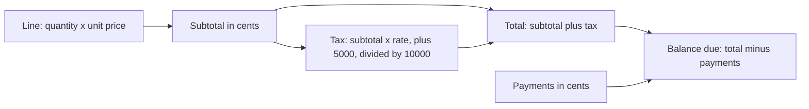

# The Invoicing Library

The library has three kinds of part. The data is the invoice and its lines. The calculations are plain functions that take an invoice and return a number or a yes or no. The reminder service sends reminders, and it depends on three things from outside itself: a clock, a store of open invoices, and a sender of reminders. Those three are called ports. Each one is an interface, so a test can swap in a stand-in.

## The data

An invoice has an identifier, the customer's name and email address, a due date, a tax rate, a list of lines, and a list of payments. A line has a description, a quantity, and a unit price. Money is held as whole cents, so 12.50 is 1250. A tax rate is held in basis points, so 8.25 percent is 825. Dates are held as text in the form `YYYY-MM-DD`.

Those choices are deliberate. A whole number of cents cannot round differently in two languages, and a date in that form cannot be read differently depending on the time zone of the machine. Both choices remove a whole category of argument before it starts, and I would rather have that argument on paper than in a bug report.

## The calculations

The calculations are small, and none of them depend on anything outside the invoice. That makes them the easiest part to test, which is also why they tend to get tested first while the rest gets left for later.

- The subtotal is the quantity times the unit price for each line, added together.
- The tax is the subtotal times the rate, rounded half up to the cent.
- The total is the subtotal plus the tax.
- The balance due is the total less the payments. A negative balance is a credit.
- An invoice is overdue when money is still owed and today is after the due date.

The calculations depend on each other. The diagram shows which number feeds which, so you can see where a wrong value would come from.



## One invoice, worked out by hand

Take an invoice with one line: two widgets at 12.50 each, taxed at 8.25 percent, with nothing paid yet.

- The subtotal is 2 times 1250 cents, which is 2500 cents, or 25.00.
- The tax is 8.25 percent of 2500 cents, which is 206.25 cents. Rounded half up to the cent, that is 206 cents, or 2.06.
- The total is 2500 plus 206, which is 2706 cents, or 27.06.
- The balance due is the total, 2706 cents, because nothing has been paid.

Those are the expected values for the tests in the rest of the tutorial. I worked them out by hand from the rules, not by running the library, and that is deliberate. A test that copies its expected value from the library's own output would pass even when the library is wrong. The tutorial never does that, and you shouldn't either.

## The same invoice in each language

The data looks the same in each language, with the names written in that language's style. Here it is as the library's own code creates it. Each tab is a sample you can run.

~~~examples
```csharp
using Invoicing;

var invoice = new Invoice(
    Id: "INV-1001",
    CustomerName: "Alice Carter",
    CustomerEmail: "alice.carter@example.invalid",
    DueDate: "2026-11-01",
    TaxRateBasisPoints: 825,
    Lines: new[] { new InvoiceLine("Widget", 2, 1250) },
    PaymentsCents: Array.Empty<long>());

Console.WriteLine(Invoices.TotalCents(invoice)); // 2706
```
```python
from invoicing import Invoice, InvoiceLine, total_cents

invoice = Invoice(
    id="INV-1001",
    customer_name="Alice Carter",
    customer_email="alice.carter@example.invalid",
    due_date="2026-11-01",
    tax_rate_basis_points=825,
    lines=(InvoiceLine("Widget", 2, 1250),),
)

print(total_cents(invoice))  # 2706
```
```javascript
import { totalCents } from './invoicing/index.js';

const invoice = {
  id: 'INV-1001',
  customerName: 'Alice Carter',
  customerEmail: 'alice.carter@example.invalid',
  dueDate: '2026-11-01',
  taxRateBasisPoints: 825,
  lines: [{ description: 'Widget', quantity: 2, unitPriceCents: 1250 }],
  paymentsCents: [],
};

console.log(totalCents(invoice)); // 2706
```
~~~

Each tab prints:

~~~text
2706
~~~

Running any of the three tabs prints 2706, which matches the hand calculation. Chapter 1 runs a version of it.

> **Aside: where the reminder service fits.** The reminder service is the one part of the library that computes nothing. It asks the clock for today, asks the store for the open invoices, and sends a reminder for each overdue one. Most of the mocking in this tutorial is about that part.

> **Common mistake.** Reading the three versions as three different invoices. They are the same invoice. If the languages ever disagree about the total, one of the ports is wrong, and a test with the same name in each language would catch it.

---
