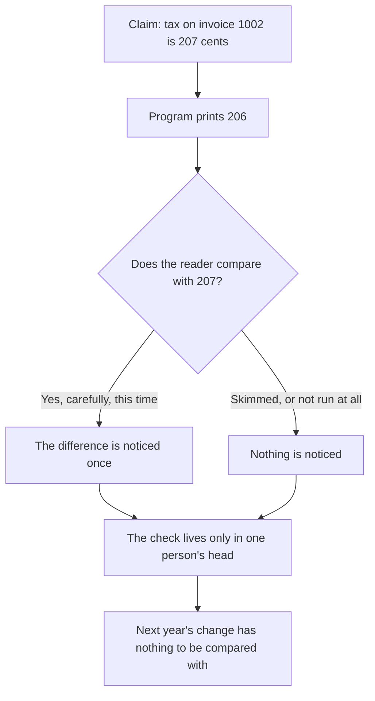

# Looking Is Not Checking

The library said 206 for the tax on INV-1001, and you worked out 206 by hand. So you are satisfied. The useful question now is whether you would have noticed if the library were wrong.

Let's find out. This step adds a second invoice, INV-1002: three widgets at 8.35 each, which is 2505 cents before tax. Working it out by hand, 2505 times 825 basis points gives 206.6625 cents of tax. Rounded half up to the nearest cent, that is 207.

The program also includes a broken version of the tax rule. The broken rule drops the fraction of a cent instead of rounding it. It is an easy bug to write, because it is what plain division does, and nobody sets out to write it. The program prints the library's tax beside the broken tax for both invoices.

~~~examples
```csharp
using Invoicing;

// Broken on purpose. It drops the fraction of a cent instead of rounding half up.
long TruncatedTax(long subtotalCents, int rateBasisPoints) => subtotalCents * rateBasisPoints / 10000;

var first = new Invoice(
    Id: "INV-1001",
    CustomerName: "Alice Carter",
    CustomerEmail: "alice.carter@example.invalid",
    DueDate: "2026-11-01",
    TaxRateBasisPoints: 825,
    Lines: new[] { new InvoiceLine("Widget", 2, 1250) },
    PaymentsCents: Array.Empty<long>());

var second = new Invoice(
    Id: "INV-1002",
    CustomerName: "Bob Diaz",
    CustomerEmail: "bob.diaz@example.invalid",
    DueDate: "2026-11-01",
    TaxRateBasisPoints: 825,
    Lines: new[] { new InvoiceLine("Widget", 3, 835) },
    PaymentsCents: Array.Empty<long>());

Console.WriteLine($"INV-1001 library {Invoices.TaxCents(first)} truncated {TruncatedTax(Invoices.SubtotalCents(first), 825)}");
Console.WriteLine($"INV-1002 library {Invoices.TaxCents(second)} truncated {TruncatedTax(Invoices.SubtotalCents(second), 825)}");
```
```python
from invoicing import Invoice, InvoiceLine, subtotal_cents, tax_cents

# Broken on purpose. It drops the fraction of a cent instead of rounding half up.
def truncated_tax(subtotal, rate):
    return subtotal * rate // 10000

first = Invoice(
    id="INV-1001",
    customer_name="Alice Carter",
    customer_email="alice.carter@example.invalid",
    due_date="2026-11-01",
    tax_rate_basis_points=825,
    lines=(InvoiceLine("Widget", 2, 1250),),
)

second = Invoice(
    id="INV-1002",
    customer_name="Bob Diaz",
    customer_email="bob.diaz@example.invalid",
    due_date="2026-11-01",
    tax_rate_basis_points=825,
    lines=(InvoiceLine("Widget", 3, 835),),
)

print(f"INV-1001 library {tax_cents(first)} truncated {truncated_tax(subtotal_cents(first), 825)}")
print(f"INV-1002 library {tax_cents(second)} truncated {truncated_tax(subtotal_cents(second), 825)}")
```
```javascript
import { subtotalCents, taxCents } from './invoicing/index.js';

// Broken on purpose. It drops the fraction of a cent instead of rounding half up.
const truncatedTax = (subtotal, rate) => Math.floor((subtotal * rate) / 10000);

const first = {
  id: 'INV-1001',
  customerName: 'Alice Carter',
  customerEmail: 'alice.carter@example.invalid',
  dueDate: '2026-11-01',
  taxRateBasisPoints: 825,
  lines: [{ description: 'Widget', quantity: 2, unitPriceCents: 1250 }],
  paymentsCents: [],
};

const second = {
  id: 'INV-1002',
  customerName: 'Bob Diaz',
  customerEmail: 'bob.diaz@example.invalid',
  dueDate: '2026-11-01',
  taxRateBasisPoints: 825,
  lines: [{ description: 'Widget', quantity: 3, unitPriceCents: 835 }],
  paymentsCents: [],
};

console.log(`INV-1001 library ${taxCents(first)} truncated ${truncatedTax(subtotalCents(first), 825)}`);
console.log(`INV-1002 library ${taxCents(second)} truncated ${truncatedTax(subtotalCents(second), 825)}`);
```
~~~

It should print this:

~~~text
INV-1001 library 206 truncated 206
INV-1002 library 207 truncated 206
~~~

Look at the first line. The library and the broken rule both say 206. If you had checked INV-1001 by eye, you would have passed the broken rule. The reason is that the fraction on that invoice is a quarter of a cent, below half, so truncating and rounding give the same whole cent. The check was right for that invoice and blind to the bug.

Only the second line shows the difference. Here the fraction is more than half a cent, so the two rules disagree, and the output shows it. The difference is there in the output, but only for an invoice you thought to check.

That is the first shortfall of checking by hand, and it has three parts.

1. **It is not repeated exactly.** The check depends on which invoice you pick, how you read the numbers, and how carefully you compare them this time. Tomorrow you might pick a different invoice, or read the same numbers more quickly.
2. **It is skipped.** Nothing runs the check unless someone remembers to. A change made on a Friday afternoon can ship on Monday, and nobody reruns the look, because the look is a habit and habits go missing.
3. **It keeps no expected answer.** The 206 you checked lives in your head, or in a terminal window that someone will close. When the rate code changes next year, there is nothing to compare against except your memory of what the output said.

The flow follows the broken rule from the claim to what a reader sees. Nothing on the path records the claim, so nothing compares the output with it later.



> **Aside: where a check by eye earns its keep.** When you are exploring something new and do not yet know what the answer should be, reading the output is the right thing to do. Looking at a result is how you learn what to expect. The trouble starts when the same look is used as the check for a rule that someone has already decided.

> **Common mistake.** Checking one input, seeing a sensible number, and calling the rule proven. The number you checked is the only one you checked. The second invoice was on screen the whole time, and it was the one that showed the bug.

---
