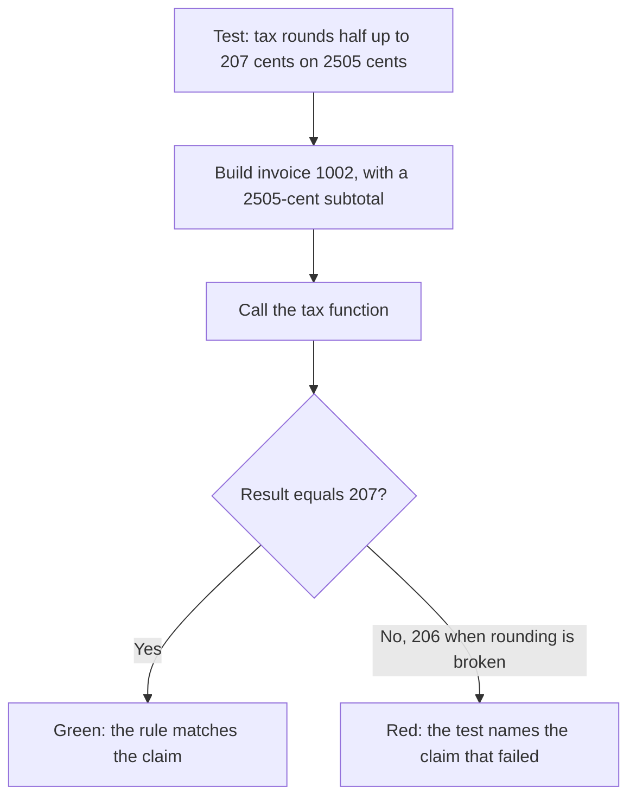

# The Same Check as a Test

Dana's console check worked, but it only made noise when someone read the output. Her team wants a result the build can act on, so she turns the check into a test and lets the framework keep the result. Then she does what this chapter keeps coming back to: she breaks the rounding on purpose, to see whether the test notices.

The check in the last step worked, but its result lived only in the output. The check you did by eye earlier in this chapter had three parts. There was an input, INV-1002. There was an expected answer, 207, which you worked out by hand. And there was a comparison, which you did in your head. A test is that same check with each part written down, so the computer does the comparison every time the code runs.

The test is the same check, written down. The flow shows each step the computer now runs, and the two ways it can end.



Here is the rounding check for INV-1002 in each language. The C#, Python and JavaScript versions are the test files for this step. Open them from the file menu to read them. You will not edit them here. Run executes them against the library. The test name is the claim, written in plain English. The names are the same in all three languages, and so is the expected value.

This is where the three test frameworks appear for the first time. C# uses NUnit, where a test is a method marked `[Test]`, and `Assert.That` makes the comparison. Python uses pytest, where a test is a function whose name starts with `test_`, and a plain `assert` makes the comparison. JavaScript uses `node:test`, which is built into Node, so it needs no install. There, `test` takes a name and a function, and `assert.equal` makes the comparison. The appendix sets all three side by side.

~~~examples readonly
```csharp
using Invoicing;
using NUnit.Framework;

namespace Invoicing.Tests;

[TestFixture]
public class TaxRoundingTests
{
    [Test]
    public void Tax_rounds_half_up_to_207_cents_on_2505_cents()
    {
        var invoice = new Invoice(
            Id: "INV-1002",
            CustomerName: "Bob Diaz",
            CustomerEmail: "bob.diaz@example.invalid",
            DueDate: "2026-11-01",
            TaxRateBasisPoints: 825,
            Lines: new[] { new InvoiceLine("Widget", 3, 835) },
            PaymentsCents: Array.Empty<long>());

        Assert.That(Invoices.TaxCents(invoice), Is.EqualTo(207));
    }
}
```
```python
from invoicing import Invoice, InvoiceLine, tax_cents


def test_tax_rounds_half_up_to_207_cents_on_2505_cents():
    invoice = Invoice(
        id="INV-1002",
        customer_name="Bob Diaz",
        customer_email="bob.diaz@example.invalid",
        due_date="2026-11-01",
        tax_rate_basis_points=825,
        lines=(InvoiceLine("Widget", 3, 835),),
    )

    assert tax_cents(invoice) == 207
```
```javascript
import { test } from 'node:test';
import assert from 'node:assert/strict';
import { taxCents } from './invoicing/index.js';

test('tax rounds half up to 207 cents on 2505 cents', () => {
  const invoice = {
    id: 'INV-1002',
    customerName: 'Bob Diaz',
    customerEmail: 'bob.diaz@example.invalid',
    dueDate: '2026-11-01',
    taxRateBasisPoints: 825,
    lines: [{ description: 'Widget', quantity: 3, unitPriceCents: 835 }],
    paymentsCents: [],
  };

  assert.equal(taxCents(invoice), 207);
});
```
~~~

Against the real library, the test passes. That tells you the library agrees with the claim. It does not yet tell you the test can catch anything, and that is the part that matters.

Now break the rule. This is the only code you change in this step, and you change one line of it. Take out the `+ 5000` that does the rounding in the library function. That turns half-up rounding into the truncation from the last step. The line to change is:

- C#: `TaxCents` in `invoicing/Invoices.cs`
- Python: `tax_cents` in `invoicing/invoice.py`
- JavaScript: `taxCents` in `invoicing/invoice.js`

The runner makes a copy of the library for this step, and it changes only that copy. The library in `samples/` is never touched, so you can break it as often as you like. Run the test again. It fails, and it reports that it expected 207 and got 206. The test has caught the broken rule, which the eye check could not. Put the `+ 5000` back, and the test passes again.

> **Aside: why the expected value is 207 and not whatever the library says.** You worked 207 out by hand earlier in this chapter, from the rule. If the test had copied the library's answer, it would pass on the broken copy too, and it would prove nothing. Chapter 11 is about tests that do exactly that, so this is the first and last time this warning is a footnote.

> **Common mistake.** Running a new test once against the working code, seeing it pass, and stopping there. A test that has never failed has not yet shown that it can. The break is what makes the test worth its place.

This is homework. Make the change yourself, in the copy, and Run to see what happens. Press Show solution (spoiler) only after you've tried it. The solution is the whole library file with the rounding term removed, so use it to check your work.

---
