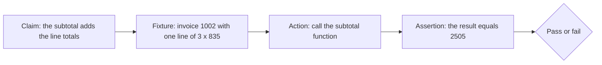

# The Four Parts of a Test

Every test in this tutorial has four parts, in every language. Learn to spot each one, and you can read any test someone else wrote. Here is the short version:

| Part | What it is | Where to find it |
| --- | --- | --- |
| **Claim** | What the test says should be true. | The name, and the comment above the fixture. |
| **Fixture** | The data the test starts from. | The invoice the test builds first. |
| **Action** | The one call that does the work. | The call to the library. |
| **Assertion** | The comparison that decides whether the claim held. | The last line. |

Now take them one at a time. The test in this step is for the subtotal of INV-1002, and the files are read-only. Open them from the file menu when you want the full text.

## The claim

A claim is one sentence about what should be true. For this test, the claim is that the subtotal of INV-1002 is 2505 cents. You can find it in the name of the test and in the comment above the fixture.

A good claim says one thing and gives one answer. If the claim is about the subtotal, a failure tells you the subtotal is wrong, and nothing else.

The four parts of a test form one path. The claim decides the fixture and the assertion, and the action connects them.



## The fixture

The fixture is the data the test starts from. Here is the invoice the test builds:

~~~examples readonly
```csharp
var invoice = new Invoice(
    Id: "INV-1002",
    CustomerName: "Bob Diaz",
    CustomerEmail: "bob.diaz@example.invalid",
    DueDate: "2026-11-01",
    TaxRateBasisPoints: 825,
    Lines: new[] { new InvoiceLine("Widget", 3, 835) },
    PaymentsCents: Array.Empty<long>());
```
```python
invoice = Invoice(
    id="INV-1002",
    customer_name="Bob Diaz",
    customer_email="bob.diaz@example.invalid",
    due_date="2026-11-01",
    tax_rate_basis_points=825,
    lines=(InvoiceLine("Widget", 3, 835),),
)
```
```javascript
const invoice = {
  id: 'INV-1002',
  customerName: 'Bob Diaz',
  customerEmail: 'bob.diaz@example.invalid',
  dueDate: '2026-11-01',
  taxRateBasisPoints: 825,
  lines: [{ description: 'Widget', quantity: 3, unitPriceCents: 835 }],
  paymentsCents: [],
};
```
~~~

The invoice has one line: three widgets at 835 cents each, which is 2505 cents before tax. The test does not work anything out. The fixture only supplies the input, and the numbers were chosen so that you can check the answer by hand.

## The action

The action is the one call that does the work. Here it is, with the result kept in a variable:

~~~examples readonly
```csharp
var result = Invoices.SubtotalCents(invoice);
```
```python
result = subtotal_cents(invoice)
```
```javascript
const result = subtotalCents(invoice);
```
~~~

The call to the library is the thing under test. When this test fails, the call is the first place to look.

## The assertion

The assertion compares the result with the claim:

~~~examples readonly
```csharp
Assert.That(result, Is.EqualTo(2505));
```
```python
assert result == 2505
```
```javascript
assert.equal(result, 2505);
```
~~~

If the comparison is true, the test passes. If it is false, the test fails. The next step lists the other comparisons you can make, because not every claim is "equal to one number."

## The whole test

Here is the full test, with each part marked by a comment:

~~~examples readonly
```csharp
using Invoicing;
using NUnit.Framework;

namespace Invoicing.Tests;

[TestFixture]
public class SubtotalTests
{
    [Test]
    public void Subtotal_adds_the_line_totals()
    {
        // Claim: the subtotal is the sum of quantity times unit price over the lines.
        // Fixture: one line, three widgets at 835 cents, so the subtotal should be 2505.
        var invoice = new Invoice(
            Id: "INV-1002",
            CustomerName: "Bob Diaz",
            CustomerEmail: "bob.diaz@example.invalid",
            DueDate: "2026-11-01",
            TaxRateBasisPoints: 825,
            Lines: new[] { new InvoiceLine("Widget", 3, 835) },
            PaymentsCents: Array.Empty<long>());

        // Action and assertion: ask the library for the subtotal, and check it against the claim.
        Assert.That(Invoices.SubtotalCents(invoice), Is.EqualTo(2505));
    }
}
```
```python
from invoicing import Invoice, InvoiceLine, subtotal_cents


def test_subtotal_adds_the_line_totals():
    # Claim: the subtotal is the sum of quantity times unit price over the lines.
    # Fixture: one line, three widgets at 835 cents, so the subtotal should be 2505.
    invoice = Invoice(
        id="INV-1002",
        customer_name="Bob Diaz",
        customer_email="bob.diaz@example.invalid",
        due_date="2026-11-01",
        tax_rate_basis_points=825,
        lines=(InvoiceLine("Widget", 3, 835),),
    )

    # Action and assertion: ask the library for the subtotal, and check it against the claim.
    assert subtotal_cents(invoice) == 2505
```
```javascript
import { test } from 'node:test';
import assert from 'node:assert/strict';
import { subtotalCents } from './invoicing/index.js';

test('subtotal adds the line totals', () => {
  // Claim: the subtotal is the sum of quantity times unit price over the lines.
  // Fixture: one line, three widgets at 835 cents, so the subtotal should be 2505.
  const invoice = {
    id: 'INV-1002',
    customerName: 'Bob Diaz',
    customerEmail: 'bob.diaz@example.invalid',
    dueDate: '2026-11-01',
    taxRateBasisPoints: 825,
    lines: [{ description: 'Widget', quantity: 3, unitPriceCents: 835 }],
    paymentsCents: [],
  };

  // Action and assertion: ask the library for the subtotal, and check it against the claim.
  assert.equal(subtotalCents(invoice), 2505);
});
```
~~~

Run the test. It passes, and it should. A passing test is only good news when it could have failed. The steps after this one show tests that pass when they should not.

---
