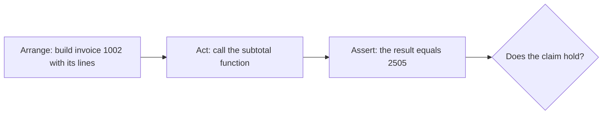

# Arrange, Act, Assert

Every test in this tutorial has three sections, in every language. Test writers call them arrange, act and assert. They map onto the four parts from the last chapter, and they are the order you work through when you write a test.

| Section | Also called | What it does |
| --- | --- | --- |
| **Arrange** | the fixture | Builds the invoice the test starts from. |
| **Act** | the action | Makes the one call that does the work. |
| **Assert** | the assertion | Compares the result with the claim. |

Take the sections one at a time. The test file for this step is read-only. Open it from the file menu whenever you want the full text, and Run executes it.

Arrange, act and assert run in order, and only the assert decides the result.



## Arrange

Arrange builds everything the test needs before it does anything. Here, that is the INV-1002 invoice: one line of three widgets at 835 cents each, with 825 basis points of tax. Nothing is calculated yet. You are only setting the scene.

~~~examples readonly
```csharp
var invoice = new Invoice(
    Id: "INV-1002",
    CustomerName: "Bob Diaz",
    CustomerEmail: "bob.diaz@example.invalid",
    DueDate: "2026-11-01",
    TaxRateBasisPoints: 825,
    Lines: new[] { new InvoiceLine("Widget", 3, 835) },
    PaymentsCents: Array.Empty<long>());
```
```python
invoice = Invoice(
    id="INV-1002",
    customer_name="Bob Diaz",
    customer_email="bob.diaz@example.invalid",
    due_date="2026-11-01",
    tax_rate_basis_points=825,
    lines=(InvoiceLine("Widget", 3, 835),),
)
```
```javascript
const invoice = {
  id: 'INV-1002',
  customerName: 'Bob Diaz',
  customerEmail: 'bob.diaz@example.invalid',
  dueDate: '2026-11-01',
  taxRateBasisPoints: 825,
  lines: [{ description: 'Widget', quantity: 3, unitPriceCents: 835 }],
  paymentsCents: [],
};
```
~~~

Most of a test is usually arrange. That is normal. A test that needs a big invoice, a customer and several payments will have a long arrange section, and a short act and assert.

## Act

Act makes the one call under test, and keeps the answer in a variable so the next line can look at it:

~~~examples readonly
```csharp
var result = Invoices.SubtotalCents(invoice);
```
```python
result = subtotal_cents(invoice)
```
```javascript
const result = subtotalCents(invoice);
```
~~~

The act is a single line on purpose. If the act does two things, a failure does not tell you which one broke. Keep it to one call, and the failing test points at one place in the library.

## Assert

Assert compares the result with the claim. The claim is the subtotal is 2505 cents, so the assertion compares the result with 2505:

~~~examples readonly
```csharp
Assert.That(result, Is.EqualTo(2505));
```
```python
assert result == 2505
```
```javascript
assert.equal(result, 2505);
```
~~~

This is the one line that decides whether the test passes. If the library returns 2505, the comparison is true and the test passes. If it returns anything else, the test fails and shows you both numbers.

## The whole test

Here is the full test, with the three sections marked by comments:

~~~examples readonly
```csharp
using Invoicing;
using NUnit.Framework;

namespace Invoicing.Tests;

[TestFixture]
public class TotalsTests
{
    [Test]
    public void Subtotal_of_invoice_1002_is_2505_cents()
    {
        // Claim: the subtotal is the sum of quantity times unit price, which is 2505 cents.
        // Arrange
        var invoice = new Invoice(
            Id: "INV-1002",
            CustomerName: "Bob Diaz",
            CustomerEmail: "bob.diaz@example.invalid",
            DueDate: "2026-11-01",
            TaxRateBasisPoints: 825,
            Lines: new[] { new InvoiceLine("Widget", 3, 835) },
            PaymentsCents: Array.Empty<long>());

        // Act
        var result = Invoices.SubtotalCents(invoice);
        // Assert
        Assert.That(result, Is.EqualTo(2505));
    }
}
```
```python
from invoicing import Invoice, InvoiceLine, subtotal_cents, tax_cents, total_cents


def test_subtotal_of_invoice_1002_is_2505_cents():
    # Claim: the subtotal is the sum of quantity times unit price, which is 2505 cents.
    # Arrange
    invoice = Invoice(
        id="INV-1002",
        customer_name="Bob Diaz",
        customer_email="bob.diaz@example.invalid",
        due_date="2026-11-01",
        tax_rate_basis_points=825,
        lines=(InvoiceLine("Widget", 3, 835),),
    )

    # Act
    result = subtotal_cents(invoice)
    # Assert
    assert result == 2505
```
```javascript
import { test } from 'node:test';
import assert from 'node:assert/strict';
import { subtotalCents, taxCents, totalCents } from './invoicing/index.js';

test('subtotal of invoice 1002 is 2505 cents', () => {
  // Claim: the subtotal is the sum of quantity times unit price, which is 2505 cents.
  // Arrange
  const invoice = {
    id: 'INV-1002',
    customerName: 'Bob Diaz',
    customerEmail: 'bob.diaz@example.invalid',
    dueDate: '2026-11-01',
    taxRateBasisPoints: 825,
    lines: [{ description: 'Widget', quantity: 3, unitPriceCents: 835 }],
    paymentsCents: [],
  };

  // Act
  const result = subtotalCents(invoice);
  // Assert
  assert.equal(result, 2505);
});
```
~~~

Run it. It passes. Read the sections in order, and you have read the test.

---
