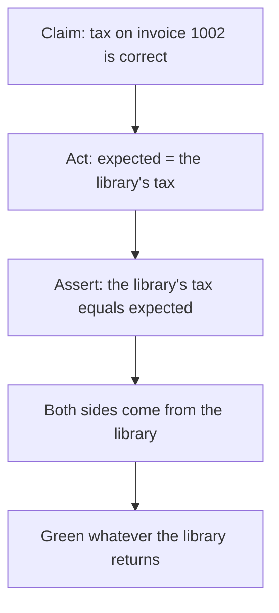
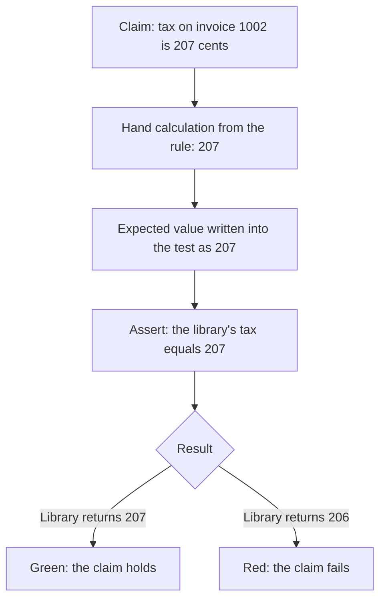

# The Copied Expected Value

A colleague of Dana's, in a hurry, wrote the tax test by asking the program for its answer and pasting that answer into the test. The test has all three sections and a good name, and it passes. That is what makes it dangerous. A passing test that copied the program will keep passing when the program is wrong.

The steps below break the rounding in a copy, so you can see what the test does when the library is wrong.

This test looks finished. It has all three sections, and its name says the tax on INV-1002 is correct. Look at the act section. It asks the library for the tax and keeps the answer as the expected value. The assert then asks the library again and compares the two answers.

## Read the two lines that matter

Two lines decide what this test checks. The first is the act. It asks the library for the tax and stores the answer in `expected`:

~~~examples readonly
```csharp
var expected = Invoices.TaxCents(invoice);
```
```python
expected = tax_cents(invoice)
```
```javascript
const expected = taxCents(invoice);
```
~~~

The second is the assert. It asks the library for the tax again and compares the two answers:

~~~examples readonly
```csharp
Assert.That(Invoices.TaxCents(invoice), Is.EqualTo(expected));
```
```python
assert tax_cents(invoice) == expected
```
```javascript
assert.equal(taxCents(invoice), expected);
```
~~~

Read it as "the tax equals the tax." The claim in the name says the tax is correct, but nothing in the test says what the correct tax is. Both sides come from the library, so whatever the library says, the test agrees.

The copied test and the worked test differ in one place: where the right answer comes from. As written, the test follows the library's answer:



The test it should be takes the answer from the hand calculation, so the library's answer can be checked against it:



## The whole test

Here is the full test, as it stands:

~~~examples readonly
```csharp
using Invoicing;
using NUnit.Framework;

namespace Invoicing.Tests;

[TestFixture]
public class TotalsTests
{
    [Test]
    public void Tax_of_invoice_1002_is_correct()
    {
        // Claim: the tax on INV-1002 is correct.
        // Arrange
        var invoice = new Invoice(
            Id: "INV-1002",
            CustomerName: "Bob Diaz",
            CustomerEmail: "bob.diaz@example.invalid",
            DueDate: "2026-11-01",
            TaxRateBasisPoints: 825,
            Lines: new[] { new InvoiceLine("Widget", 3, 835) },
            PaymentsCents: Array.Empty<long>());

        // Act
        var expected = Invoices.TaxCents(invoice);
        // Assert
        Assert.That(Invoices.TaxCents(invoice), Is.EqualTo(expected));
    }
}
```
```python
from invoicing import Invoice, InvoiceLine, subtotal_cents, tax_cents, total_cents


def test_tax_of_invoice_1002_is_correct():
    # Claim: the tax on INV-1002 is correct.
    # Arrange
    invoice = Invoice(
        id="INV-1002",
        customer_name="Bob Diaz",
        customer_email="bob.diaz@example.invalid",
        due_date="2026-11-01",
        tax_rate_basis_points=825,
        lines=(InvoiceLine("Widget", 3, 835),),
    )

    # Act
    expected = tax_cents(invoice)
    # Assert
    assert tax_cents(invoice) == expected
```
```javascript
import { test } from 'node:test';
import assert from 'node:assert/strict';
import { subtotalCents, taxCents, totalCents } from './invoicing/index.js';

test('tax of invoice 1002 is correct', () => {
  // Claim: the tax on INV-1002 is correct.
  // Arrange
  const invoice = {
    id: 'INV-1002',
    customerName: 'Bob Diaz',
    customerEmail: 'bob.diaz@example.invalid',
    dueDate: '2026-11-01',
    taxRateBasisPoints: 825,
    lines: [{ description: 'Widget', quantity: 3, unitPriceCents: 835 }],
    paymentsCents: [],
  };

  // Act
  const expected = taxCents(invoice);
  // Assert
  assert.equal(taxCents(invoice), expected);
});
```
~~~

Run it. It passes.

Now break the library, in a copy. Take out the `+ 5000` that does the rounding, in the line for the language you are reading:

- C#: `TaxCents` in `invoicing/Invoices.cs`
- Python: `tax_cents` in `invoicing/invoice.py`
- JavaScript: `taxCents` in `invoicing/invoice.js`

The runner makes that copy for this step, and it changes only that copy. The library in `samples/` is never touched.

Run it again. It still passes. The expected value came from the broken program, so the test agrees with the program, whatever the program says. The test never wrote 207 down, so it has no way to know that 207 is right. An expected value has to come from the claim and your hand calculation, and it has to be in the test before the code runs.

This is homework. Make the change yourself, in the copy, and Run to see what happens. Press Show solution (spoiler) only after you've tried it. The solution is the whole library file with the rounding term removed, so use it to check your work.

---
