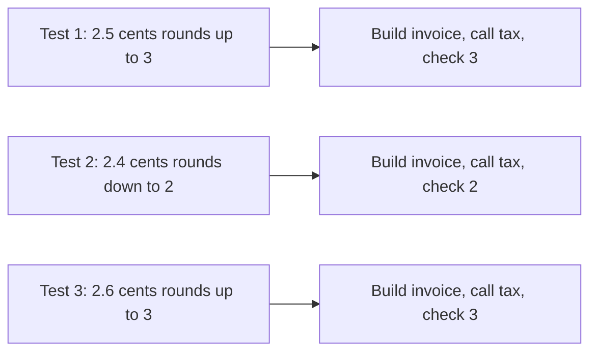

# Three Tests That Repeat Themselves

Here are three tests for the tax rounding rule. Each one checks a single case. Before you read the code, look at what the cases are.

A basis point is one hundredth of a percent, so 25 basis points is a quarter of one percent. The subtotal here is 1000 cents, which is $10.00. A quarter of one percent of 1000 cents is 2.5 cents. The tax has to be a whole number of cents, so the library rounds it. Exactly half a cent rounds up.

| Test | Subtotal | Rate in basis points | Tax before rounding | Expected tax |
| --- | --- | --- | --- | --- |
| Exactly half a cent | 1000 | 25 | 2.5 cents | 3 |
| Just under half a cent | 1000 | 24 | 2.4 cents | 2 |
| Just over half a cent | 1000 | 26 | 2.6 cents | 3 |

The first test is the one to read closely. Its arrange section builds an invoice with one line, one widget at 1000 cents, and the rate of 25 basis points:

~~~examples readonly
```csharp
var invoice = new Invoice(
    Id: "INV-A",
    CustomerName: "Test",
    CustomerEmail: "test@example.invalid",
    DueDate: "2026-11-01",
    TaxRateBasisPoints: 25,
    Lines: new[] { new InvoiceLine("Item", 1, 1000) },
    PaymentsCents: Array.Empty<long>());
```
```python
invoice = Invoice(
    id="INV-A",
    customer_name="Test",
    customer_email="test@example.invalid",
    due_date="2026-11-01",
    tax_rate_basis_points=25,
    lines=(InvoiceLine("Item", 1, 1000),),
)
```
```javascript
const invoice = {
  id: 'INV-A',
  customerName: 'Test',
  customerEmail: 'test@example.invalid',
  dueDate: '2026-11-01',
  taxRateBasisPoints: 25,
  lines: [{ description: 'Item', quantity: 1, unitPriceCents: 1000 }],
  paymentsCents: [],
};
```
~~~

The act calls the tax function, and the assert checks that the answer is 3. The other two tests have the same three sections. Only the invoice id, the rate and the expected number change.

The file is read-only, so open it from the file menu to see all three tests. Run it. All three pass.

Each test runs the same three steps on different numbers. The flow shows the copies side by side.



## What is wrong with this

Look at the three tests side by side. The arrange section is copied three times, and so are the act and assert lines. If the way an invoice is built changes, all three tests have to change in the same way. If you add a fourth case, you copy the whole test again.

The cases are the part that matters. Everything else is the same. The next step puts the cases in a table, so the test body is written once.

---
