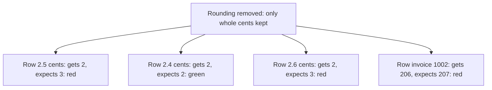

# Naming Each Case

Dana is back. She is tidying the tax code, and she finds the `+ 5000` in the middle of a division. It looks like a magic number, and she is not sure why it is there. She takes it out, because the code looks simpler without it.

The library has a test suite, so she runs it before she commits. The suite does its job. Three rows fail, and each one has a name: `half-cent-rounds-up`, `above-half-cent` and `invoice-1002`. The failure for `invoice-1002` says the library returned 206 where the claim says 207. Dana sees the names, puts the `+ 5000` back, and the suite passes again.

Now imagine the suite was not there. The change ships. Every invoice with a tax that falls on half a cent, or just above it, is one cent short. Most customers would never notice a cent. The totals would still look reasonable, and nobody would be looking for the problem. It might surface weeks later, in a reconciliation report, with no obvious cause.

That is the job of a proper test suite. It does not stop anyone from making a mistake. It makes the mistake show up on the same afternoon, with the name of the case that broke.

In this step, you are Dana. You make the same change, in a copy of the library, and you read what the suite tells you. The table is written, and right now all four rows pass. The test file is the finished one from the last step.

## The rounding line

This is the line that does the rounding. Here it is in each language:

~~~examples readonly
```csharp
public static long TaxCents(Invoice invoice) =>
    (SubtotalCents(invoice) * invoice.TaxRateBasisPoints + 5000) / 10000;
```
```python
return (subtotal_cents(invoice) * invoice.tax_rate_basis_points + 5000) // 10000
```
```javascript
return Math.floor((subtotalCents(invoice) * invoice.taxRateBasisPoints + 5000) / 10000);
```
~~~

The subtotal times the rate, divided by 10000, is the exact tax, and it can have a fraction of a cent. A basis point is one hundredth of a percent, so the division takes that percent out of the subtotal. The `+ 5000` is half of 10000. Adding it before the division means any fraction of half a cent or more rounds up. Without it, the division just cuts the fraction off, so every fraction rounds down.

With the rounding removed, the rows do not fail the same way. The flow shows which rows fail, and which one still passes.



## What the rows will show

Here is the arithmetic for each row, with the rounding removed. The exact tax is the subtotal times the rate, divided by 10000. Without the rounding, you keep only the whole cents.

| Row | Exact tax | Expected (rounded half up) | Without the rounding | Result |
| --- | --- | --- | --- | --- |
| `half-cent-rounds-up` | 1000 times 25, over 10000, is 2.5 | 3 | 2 | fails |
| `below-half-cent` | 1000 times 24, over 10000, is 2.4 | 2 | 2 | passes |
| `above-half-cent` | 1000 times 26, over 10000, is 2.6 | 3 | 2 | fails |
| `invoice-1002` | 2505 times 825, over 10000, is 206.66 | 207 | 206 | fails |

The `below-half-cent` row passes, and the reason is important. Cutting off a fraction and rounding half up give the same answer when the fraction is less than half. That row has a fraction of 0.4, so both ways give 2. The other rows have a fraction of 0.5 or more, so the cut-off answer is one cent short.

This is why the table has a case on each side of the boundary. A rounding bug shows up on one side of the boundary and not the other, so you need both sides to see it.

## Your job

Take out the `+ 5000` in the copy, in the line for the language you are reading:

- C#: `TaxCents` in `invoicing/Invoices.cs`
- Python: `tax_cents` in `invoicing/invoice.py`
- JavaScript: `taxCents` in `invoicing/invoice.js`

The runner makes that copy for this step, and it changes only the copy. The library in `samples/` is never touched.

Run the tests. You should see three rows fail, with the row names next to each one, and `below-half-cent` pass. Each failure line shows the expected number and the number the library returned, so you can check the table above against the real output. For `invoice-1002`, you should see 206 where 207 was expected.

If your results differ from the table, check the change first. Only the `+ 5000` should be gone. Anything else changed is the likely cause.

This is homework. Make the change yourself, in the copy, and Run. Press Show solution (spoiler) only after you've tried it. The solution is the whole library file with the rounding term removed, so use it to check your work.

---
