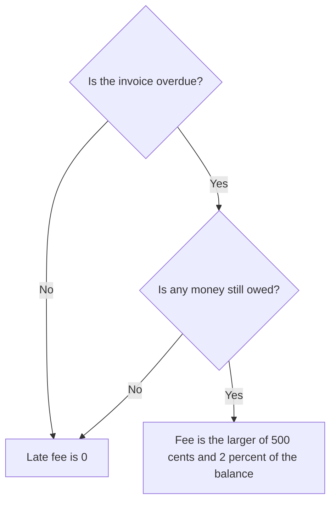
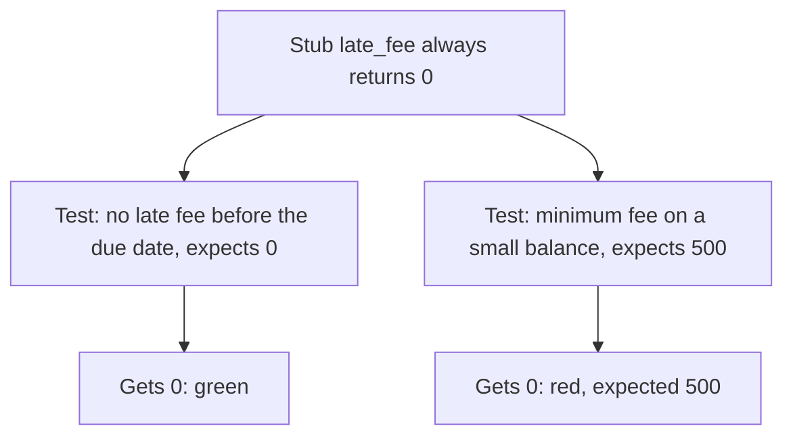

# The First Red

Dana's ticket says what the late fee is. Here is the rule in plain words:

- If the invoice is not overdue, or nothing is owed, the fee is 0.
- Otherwise the fee is 2 percent of the balance, rounded half up to the cent.
- But the fee is never less than 500 cents, the minimum fee.

Two parts of that rule need a number worked out. Two percent of a balance is the balance times 200 basis points, divided by 10000. The minimum is a fixed 500 cents. For INV-1002, the balance is 2712 cents, so 2 percent is 54 cents, and the minimum of 500 cents applies.

The library in the editor has `late_fee` as a stub. It always returns 0. So it is wrong for any overdue invoice, and right only when nothing is owed or the invoice is not yet due.

The rule is worked out before any code exists. The flow shows the decisions the late fee takes, which the tests then check one at a time.



Against the stub, which always returns 0, the two tests behave differently:



Here are the first two tests. They are written before the code, which is the point. The file is read-only in this step. Open it from the file menu to read the full text.

The first test checks the case where nothing is owed yet. Its arrange section builds INV-1002, and its act asks for the fee on 31 October, the day before the due date:

~~~examples readonly
```csharp
var result = Invoices.LateFee(invoice, "2026-10-31");
Assert.That(result, Is.EqualTo(0));
```
```python
result = late_fee(invoice, "2026-10-31")
assert result == 0
```
```javascript
const result = lateFee(invoice, '2026-10-31');
assert.equal(result, 0);
```
~~~

The second test checks an overdue invoice with a small balance. Its act asks for the fee on 14 November, two weeks after the due date:

~~~examples readonly
```csharp
var result = Invoices.LateFee(invoice, "2026-11-14");
Assert.That(result, Is.EqualTo(500));
```
```python
result = late_fee(invoice, "2026-11-14")
assert result == 500
```
```javascript
const result = lateFee(invoice, '2026-11-14');
assert.equal(result, 500);
```
~~~

Run the tests. You should see one pass and one fail:

- `no late fee before the due date` passes. The stub returns 0, and the claim is 0.
- `minimum late fee on a small balance` fails. The stub returns 0, and the claim is 500.

The first pass is not evidence that the library is right. The stub got lucky, because 0 is the answer for that case. The failure is the useful result. It shows the test can tell a wrong answer from a right one, and it shows that the rule is not written yet.

Read the failure line. It should say that the library returned 0 where the test expected 500. That is the red you wanted.

This is not homework. Nothing in this step changes. Your next step is the one that asks you to write a test.

---
