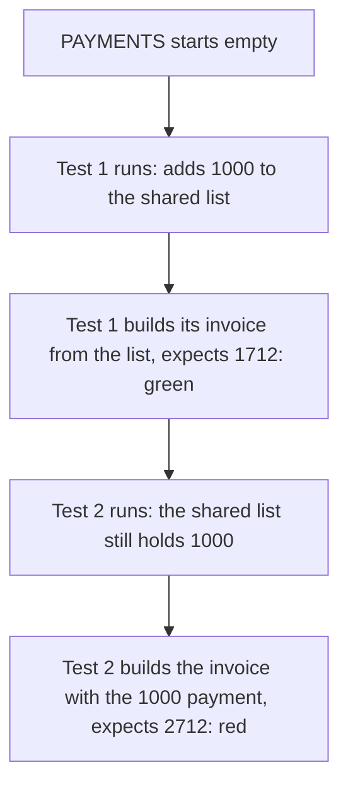

# The Shared Fixture

Dana's test is `the full balance is owed`. It builds an invoice with no payments and checks that 2712 cents are owed. Nothing about the test has changed. Yet on the build server it fails, and it says 1712 was owed.

Look at the top of the file first. There is one list, `PAYMENTS`, that every test shares. It starts empty. Each test that needs a payment adds to that list, and every later test that builds an invoice reads from it.

Here is the helper that builds the invoice. It reads the shared list each time it runs:

~~~examples readonly
```csharp
private static readonly List<long> SharedPayments = new();

private static Invoice SharedInvoice() => new Invoice(
    ...
    PaymentsCents: SharedPayments);
```
```python
PAYMENTS = []

def shared_invoice() -> Invoice:
    return Invoice(
        ...
        payments_cents=tuple(PAYMENTS),
    )
```
```javascript
const sharedPayments = [];

function sharedInvoice() {
  return {
    ...
    paymentsCents: sharedPayments,
  };
}
```
~~~

The invoice itself cannot change. It is immutable, so no test can alter its fields. The list it reads from can change, and that is the problem.

The first test adds a payment of 1000 cents to the shared list. Its claim is that 1712 cents are then owed, and that is right. The second test takes the same list, and by the time it runs, the list already holds that payment. It checks for 2712 and gets 1712.

Run the tests. In this order, the first test passes and the second fails with 1712 where it expects 2712. The second test is the one that breaks, but nothing in it is wrong. The fault is in the shared list, which the first test left behind.

The shared list is the problem. The flow shows how the first test changes it, and how the second test then reads the changed list.



Here is the same run, one stage at a time. Read down the middle column, which is the shared list:

| Stage | Shared `PAYMENTS` list | What the second test gets | Result |
| --- | --- | --- | --- |
| Before any test | empty | not run yet | not run yet |
| After the first test | `[1000]` | not run yet | not run yet |
| The second test runs, after the first | `[1000]` | an invoice with 1000 cents paid | 1712, expected 2712, so it fails |
| The second test runs alone | empty | an invoice with nothing paid | 2712, so it passes |

Nothing in the second test changed between the last two rows. Only the list did. The last row is the same test, run without the first one.

This is the danger of a shared fixture. A test that passes when it runs alone can fail when it runs after another test. The result depends on which test ran first, and a failure can point at a test that did nothing wrong.

The next step shows how to give each test its own data.

---
