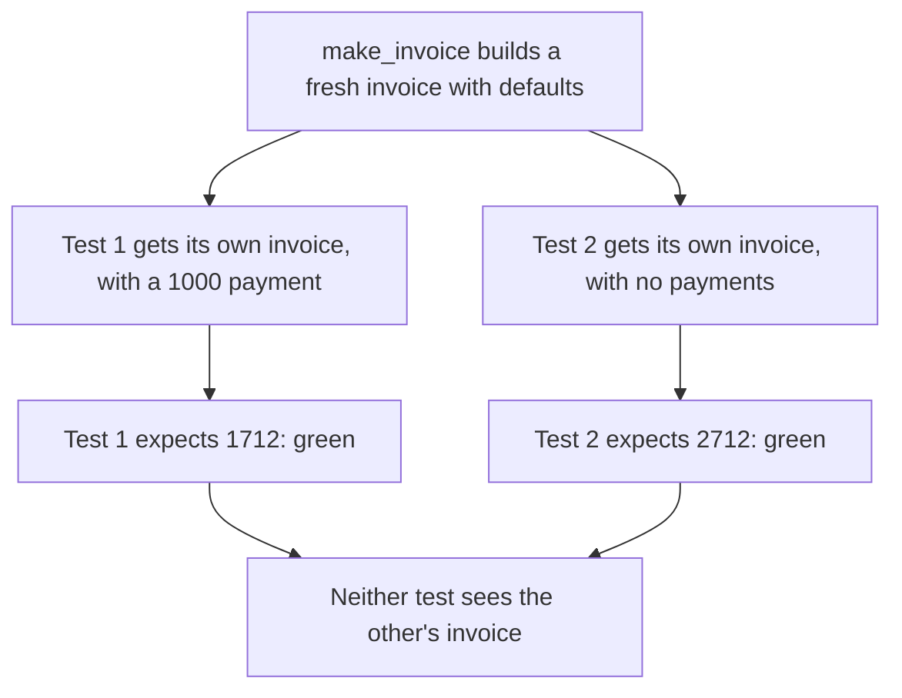

# A Builder With Defaults

The fix is a builder. A builder is a helper that makes a fixture with sensible defaults, and each test changes only the parts it is about. Here is the builder in each language, with the same defaults as the invoice you have been using:

~~~examples readonly
```csharp
private static Invoice MakeInvoice(IReadOnlyList<long>? paymentsCents = null) => new Invoice(
    ...
    PaymentsCents: paymentsCents ?? new List<long>());
```
```python
def make_invoice(**overrides) -> Invoice:
    fields = {"id": "INV-1002", ..., "payments_cents": ()}
    fields.update(overrides)
    return Invoice(**fields)
```
```javascript
function makeInvoice(overrides = {}) {
  return {
    ...defaults,
    paymentsCents: [],
    ...overrides,
  };
}
```
~~~

Read the two key lines in each one. The first is the default for payments. The second is the override: whatever a test passes in replaces the default for that one field, and leaves the rest alone.

The payments default is a new, empty value on every call. In Python it is an empty tuple, which cannot change at all. In JavaScript it is a fresh `[]` each time the function runs. In C# it is a new list each time. So every test gets its own payments, and no test can leave one behind for another.

Now look at the two tests. The first asks for one override, the payments list with 1000 cents in it. The second asks for no overrides at all, so it gets the defaults, which means no payments. Neither test mentions the other.

A builder gives each test its own invoice, so the order of the tests cannot matter. The flow shows the two tests side by side.



Here is the same two-test run as the last step, with the builder. Each test's invoice is built on its own, so the two columns on the right never touch:

| Stage | Shared between tests | First test's invoice | Second test's invoice |
| --- | --- | --- | --- |
| Before any test | nothing | not built yet | not built yet |
| The first test runs, with 1000 cents paid | nothing | 1000 cents paid, balance 1712 | not built yet |
| The second test runs, with the defaults | nothing | still 1000 cents paid, balance 1712 | nothing paid, a new empty payments value, balance 2712 |

The first test's payment stays in its own invoice, where nothing else can see it. The second test starts from its own empty value. Swap the two tests around, and the table gives the same balances.

Run the tests. Both pass. They would pass in any order, because neither one can see what the other did.

The override is the part to notice. A test should say only the field it is about. A test about payments sets the payments, and it should not repeat the rest of the invoice.

The next step asks you to write two tests with overrides of your own.

---
