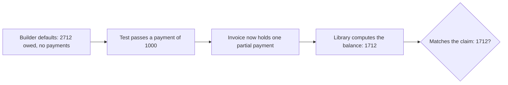

# Overrides in Your Tests

The test file has the builder from the last step and two tests. Each test needs one override and one expected balance. Both are yours to write, and both are marked with comments.

The first test is about a partial payment. The starter builds the invoice with no payments, which gives the full balance. Your job is to add a payment of 1000 cents as an override, the same way the last step did. Then work out the balance by hand. The full balance is 2712 cents, so 2712 less 1000 is the answer.

The second test is about a full payment. Add a payment of 2712 cents as an override. Then work out what is left to pay.

An override changes one part of the default invoice. The flow shows how the first homework test's payment reaches the balance it checks.



Here is the shape of an override, shown for the first test. Look at the call that builds the invoice. You only add the payment, and you leave the rest of the invoice to the defaults:

~~~examples readonly
```csharp
var invoice = MakeInvoice(new long[] { 1000 });
```
```python
invoice = make_invoice(payments_cents=(1000,))
```
```javascript
const invoice = makeInvoice({ paymentsCents: [1000] });
```
~~~

The placeholders are `None` in Python, `null` in JavaScript, and `-1` in C#. A balance cannot be `-1` in this case, so both tests fail until you replace the placeholders. Work each balance out on paper before you type it in.

Run the tests. Both should fail, because the placeholders are not balances. After you fill in the two numbers and the two overrides, both should pass.

> **Common mistake.** Writing the override into the invoice's fields instead of through the builder, or repeating the whole invoice in the test. A test that sets only the field it is about is easier to read, and it cannot disagree with the defaults.

This is homework. Make the two changes yourself, and Run. Press Show solution (spoiler) only after you've tried it. The solution is the same test file with the overrides added and the balances filled in.

---
