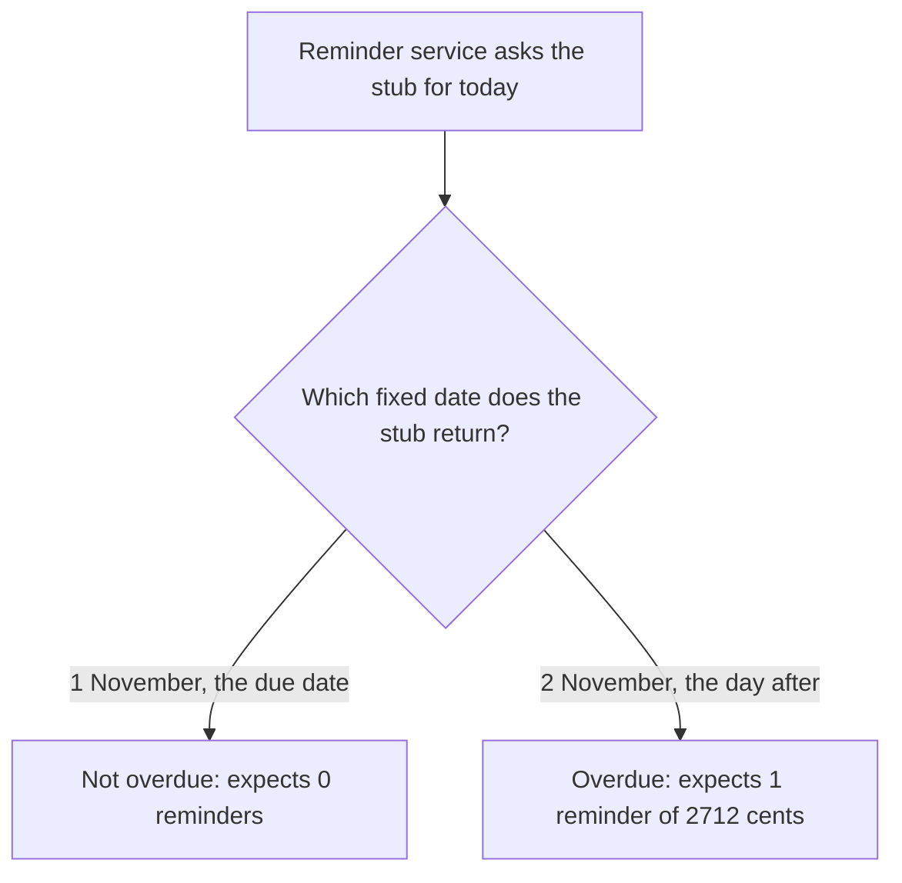

# A Stub Clock

The reminder service asks the clock for today's date, and then it compares that date with each invoice's due date. The real clock gives a different answer every day, so a test that uses it can pass today and fail tomorrow. The fix is a stub clock. It always says the same date, which the test chooses.

The stub always answers with one fixed date, so each test controls which side of the due date the service sees.



Here is the whole stub in each language. It stores one date, and its only method returns that date:

~~~examples readonly
```csharp
private sealed class StubClock : IClock
{
    private readonly string _today;
    public StubClock(string today) => _today = today;
    public string Today() => _today;
}
```
```python
class StubClock:
    def __init__(self, today: str) -> None:
        self._today = today

    def today(self) -> str:
        return self._today
```
```javascript
function stubClock(today) {
  return { today: () => today };
}
```
~~~

The service receives the clock as one of its three parts, along with a repository and a sender. The test hands the service a stub clock in place of the real one:

~~~examples readonly
```csharp
var service = new ReminderService(repository, new StubClock("2026-11-01"), sender);
```
```python
service = ReminderService(repository, StubClock("2026-11-01"), sender)
```
```javascript
const service = new ReminderService(repository, stubClock('2026-11-01'), sender);
```
~~~

Those are the two lines to read. The `StubClock` argument is the only thing in the test that decides what today is. Change that one argument, and the same test asks a different question.

The file also has a stub repository, which returns the one invoice in a list, and a fake sender, which keeps each reminder in a list. The sender is a fake and not a stub, because it has a little logic: it records what it was asked to send. The comments on each test name its double and say why.

The first test sets today to the due date. The rule is "after the due date", so no reminder should go out. The second test sets today to the day after. One reminder should go out, for 2712 cents.

Run the tests. Both pass. The result is the same on every day the test runs, because the date never changes.

This is not homework. The next step uses a fake repository, and the step after it asks you to write tests with doubles of your own.

---
