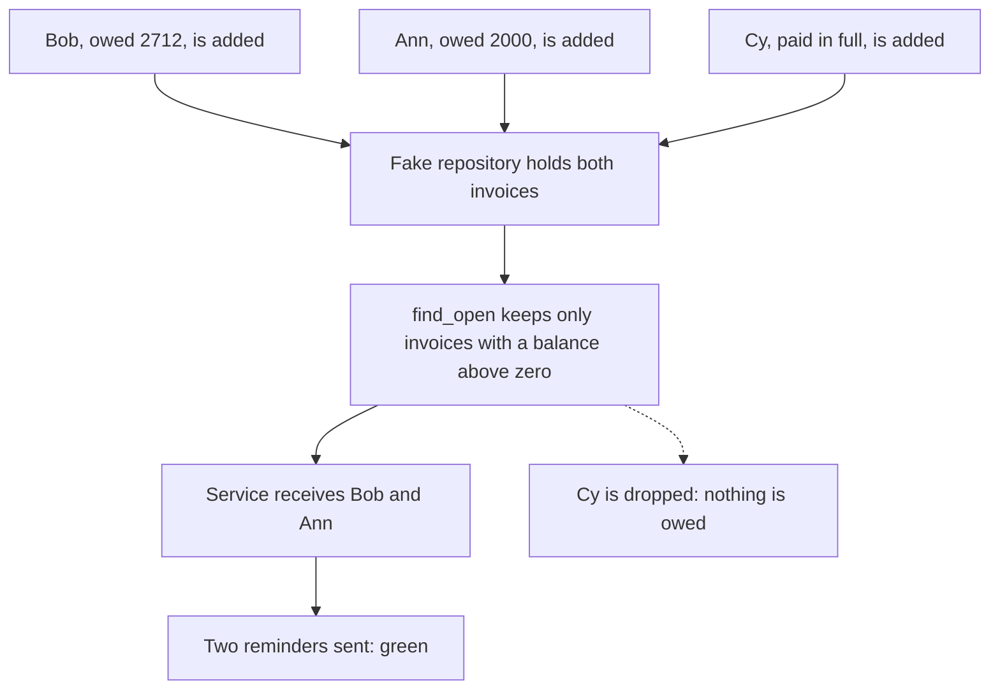

# A Fake Repository

A stub returns the same answer whatever it is asked. A fake does real work, just in a simpler way. The fake repository here keeps invoices in a list in memory, and its `find_open` works the way the real database should: it returns only the invoices that still owe money.

The fake repository holds real invoices, and its find_open rule removes the paid one. The flow shows what reaches the service.



~~~examples readonly
```csharp
private sealed class InMemoryRepository : IInvoiceRepository
{
    private readonly List<Invoice> _invoices = new();
    public void Add(Invoice invoice) => _invoices.Add(invoice);
    public IReadOnlyList<Invoice> FindOpen() =>
        _invoices.Where(invoice => Invoices.BalanceDueCents(invoice) > 0).ToList();
}
```
```python
class InMemoryRepository:
    def __init__(self) -> None:
        self._invoices: list[Invoice] = []

    def add(self, invoice: Invoice) -> None:
        self._invoices.append(invoice)

    def find_open(self) -> list[Invoice]:
        return [invoice for invoice in self._invoices if balance_due_cents(invoice) > 0]
```
```javascript
class InMemoryRepository {
  #invoices = [];

  add(invoice) {
    this.#invoices.push(invoice);
  }

  findOpen() {
    return this.#invoices.filter((invoice) => balanceDueCents(invoice) > 0);
  }
}
```
~~~

The fake has logic, so it can be wrong in the same ways a real repository can. That is why the library's own rule for "still owed" is used inside it, rather than a fixed list.

The sender is a fake too, and it does something different. The library tells it to send a reminder, and it writes the reminder into a list. The test then reads that list. Here the test checks the state after the work, which is what was sent. It does not check how many times the sender was called. That difference matters, and the chapter on mocks returns to it.

Now look at the two tests. The first gives the service two invoices, one owed by Bob and one by Ann, with a clock set to 14 November. Both are overdue, so two reminders should go out, each with its own address and amount. The test checks the whole list the sender recorded.

The second test adds a paid invoice next to Bob's. The fake leaves the paid one out, and the test checks that only Bob's reminder was sent.

Run the tests. Both pass. Each test names its doubles and says why it uses them, as the last step did.

The next step asks you to write two tests with doubles of your own.

---
