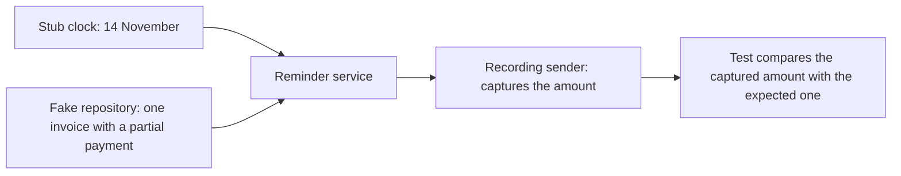

# Doubles in Your Tests

The test file has the fake repository, the stub clock and the recording fake sender from the last two steps, and two tests. Each test needs one piece of work from you: the invoice's payment, and the expected result.

In the first test, the invoice starts with no payment, so the reminder would show the full balance. Give the invoice a payment of 1000 cents as a constructor argument, then work out the balance after that payment and type it in. The reminder amount is what the sender should record.

In the second test, the invoice should be paid in full. Give it a payment of 2712 cents. Then decide how many reminders should go out. Work it out from the rule, not from what the code prints.

The placeholders are `None` in Python, `null` in JavaScript, and `-1` in C#. Both tests fail until you replace them. Work each value out on paper first.

Each test uses a double for each dependency. The flow shows what each one contributes to the check.



Here is the shape of the change, shown for the first test:

~~~examples readonly
```csharp
repository.Add(MakeInvoice(new long[] { 1000 }));
```
```python
repository.add(make_invoice(payments_cents=(1000,)))
```
```javascript
repository.add(makeInvoice([1000]));
```
~~~

> **Common mistake.** Copying the number the sender recorded and pasting it into the test. A test written that way agrees with the code, whatever the code does, and it cannot tell you anything. Work the balance out from the rule first.

This is homework. Make the two changes yourself, and Run. Press Show solution (spoiler) only after you've tried it. The solution is the same test file with the payments added and the expected values filled in.

---
