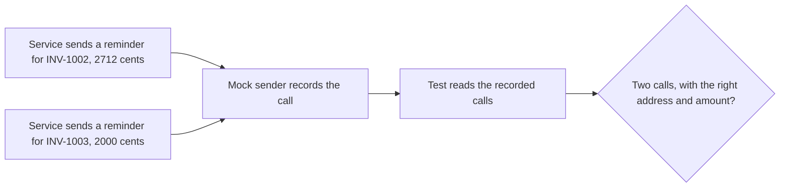

# Checking the Calls

The sender in this test is a mock. It does nothing with the reminders. It only records each call, so the test can ask what was called, and with what.

The sender is a mock, so the test can read every call the service made to it. The flow shows the two calls it should record.



Here is how a mock is made in each language:

~~~examples readonly
```csharp
var sender = Substitute.For<IReminderSender>();
```
```python
sender = Mock()
```
```javascript
const send = mock.fn();
const sender = { send };
```
~~~

Now read the assert section. The first line checks the count: exactly two calls. The second line checks the calls themselves, in order, with the address, the invoice and the amount for each one. Each call is one reminder the library asked the sender to send.

The `Received` line in C# does the same job as the call list in Python and JavaScript. Its first line checks the count, and the next two check the arguments of each call.

Why check the calls here, when the service also returns the count? Because the count is the service's own tally. A sender that does nothing would still leave the count at two. The calls are what actually left the library, so they are the claim.

The mock sits at the sender, which is a boundary. The fake repository and the stub clock are doubles too, but they are doubles of data, and the test only needs their answers. Only the sender is checked by its calls.

Run the tests. Both pass. They would fail if the service sent the wrong amount, sent a reminder to the wrong address, or sent one reminder too many.

This is not homework. The next step checks the opposite case, where the sender should not be called at all.

---
