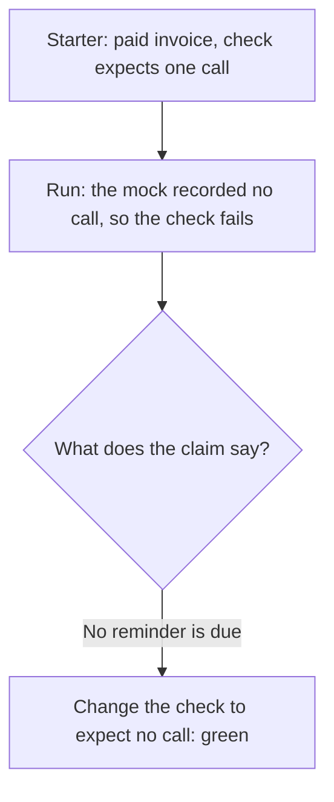

# Calls in Your Tests

The test file has two tests. Each one has a check that does not match its claim, or a value you have to work out. Run them first, and read what the mock says.

The first test claims that a paid invoice causes no calls to the sender. The check says the sender was called once. Run it, and the mock reports that the call never happened. That is the opposite of what the claim says, so the failure is correct. Change the check to say the claim, that no call was made. The matching check is in the last step.

The second test claims that the amount in the call is the balance after a partial payment of 1000 cents. The starter has a placeholder where the amount goes. Work out the balance on paper, from the rule, and type it in. The failure shows the amount the library actually sent, and it should match once your value is right.

The starter's check expects a call, but the claim says none should happen. The flow shows the decision you make.



Here is the shape of the first change, in each language:

~~~examples readonly
```csharp
sender.DidNotReceive().Send(Arg.Any<string>(), Arg.Any<string>(), Arg.Any<long>());
```
```python
sender.send.assert_not_called()
```
```javascript
assert.equal(send.mock.callCount(), 0);
```
~~~

> **Common mistake.** Changing the check until the test passes, instead of asking what the claim says. A mock that was never called is a result. If the claim says "no call", the test should check for no call, and the failure tells you the library sent one.

This is homework. Make the two changes yourself, and Run. Press Show solution (spoiler) only after you've tried it. The solution is the same test file with the check and the amount corrected.

---
