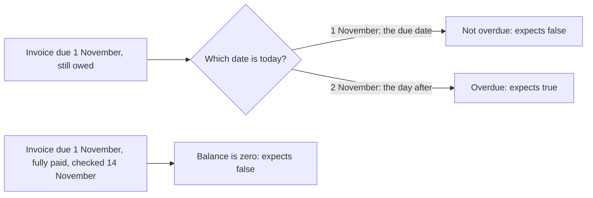

# The Edge of the Due Date

A rule is usually wrong at its edges, not in the middle. "Overdue after the due date" is fine on 14 November, when the due date was in October. It is easy to get wrong on the day itself, and the day after. A test that only checks the clear cases will pass even when the edge is broken.

This step tests the three edges of the overdue rule. Each test has one claim, and the claim names the exact date or state at the edge.

Start with the first test. The arrange section makes an unpaid invoice due on 1 November. The act section asks whether it is overdue on 1 November itself. The assert says no. The claim is "not overdue on the due date," and the date in the test is the due date, not a date near it.

The second test uses the day after: 2 November. The assert says yes. Together, the two tests pin the boundary. If someone changes "after" to "on or after," the first test fails. That is the change Dana's team once made by mistake, and it sent reminders on the due date.

The third test checks a paid invoice a long time after its due date. The claim is that money must still be owed, so an invoice with nothing left to pay is never overdue. The arrange section pays the full total, 2712 cents, which you can check from the earlier chapters.

The three tests cover the three edges of the claim: the due date, the day after it, and a paid invoice. The flow shows each path and the answer it expects.



Here is the first test in each language:

~~~examples readonly
```csharp
var result = Invoices.IsOverdue(invoice, "2026-11-01");
Assert.That(result, Is.False);
```
```python
result = is_overdue(invoice, "2026-11-01")
assert result is False
```
```javascript
const result = isOverdue(invoice, '2026-11-01');
assert.equal(result, false);
```
~~~

Run the three tests. They pass. They are not homework, because the claim is already true in the library. Their job is to fail if the boundary moves.

> **A note on the date.** The date is written as text, `"2026-11-01"`, because the library reads dates as ISO text. Writing a date as a real date object would hide the format from the test, and the next chapter's rules about dates would be harder to see.

---
