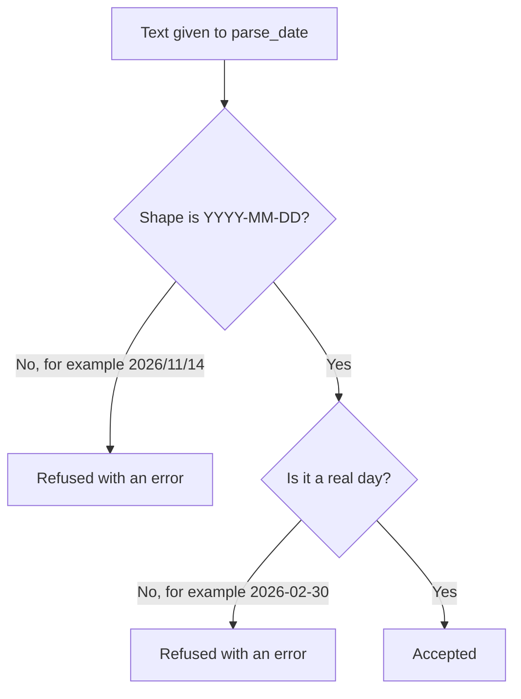

# Refusing a Bad Date

Some input should never be accepted. A date that does not exist, such as 30 February, is a mistake in the data. The library's answer is to refuse it, with an error. The test's job is to check that the refusal happens.

Read the first test. The arrange section is one string, `"2026-02-30"`. The act and assert section is the refusal check. Each language has its own way of asking for an error. Python uses `pytest.raises`, JavaScript uses `assert.throws`, and C# uses `Throws.TypeOf`. In each case the check says which kind of error is expected.

That check is about the type. The claim is "the library refuses it," and the type of error is what the library promised to raise. So the test names the type, `ValueError` in Python, `RangeError` in JavaScript, and `FormatException` in C#. A test that only says "something was thrown" would pass for any error, including a typo in the code that raised a different error by accident.

The second test uses a date in the wrong shape, with slashes. The claim is about the format, not the calendar. The library refuses any text that is not `YYYY-MM-DD`, even a date that would be valid in another format. The check is the same, and it is the same kind of error.

The library accepts a date only if it has the YYYY-MM-DD shape and names a real day. The flow shows both refusals.



Here is the first test in each language:

~~~examples readonly
```csharp
Assert.That(() => Dates.Parse(text), Throws.TypeOf<FormatException>());
```
```python
with pytest.raises(ValueError):
    parse_date(text)
```
```javascript
assert.throws(() => parseDate(text), RangeError);
```
~~~

> **Common mistake.** Writing a refusal test that catches everything. A bare `except` or a `Throws.Exception` would pass even if the library crashed for a reason unrelated to the date. Name the type the claim promises.

Run the tests. They pass, and they are not homework. The next step gives you one to write yourself.

---
