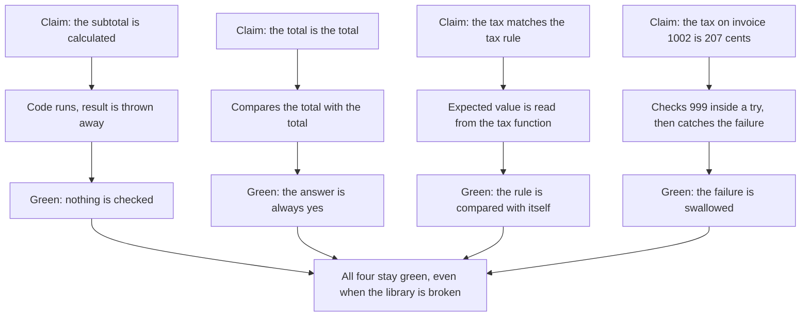
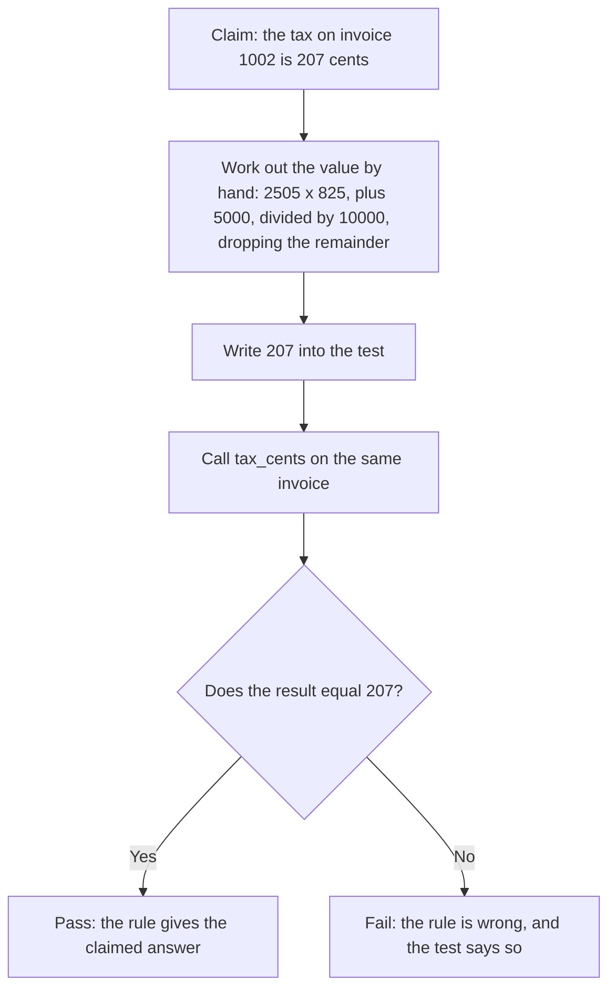

# Passing for the Wrong Reason

A green test is only good news when it could have been red. Each test in this step is green, and each one would stay green if the library were broken. The four tests show four common ways that happens.

Each test has a claim in its name and in its comment. Read the claim first, then the code, and ask whether the code could ever fail.

**No assertion.** The first test calls `subtotal` and never checks the result. It runs the code and then stops. It passes unless the code throws. The name says the subtotal is calculated, but the test does not check it.

**A tautology.** The second test asserts that the total equals the total. Both sides call the same function on the same invoice, so the answer is always yes. A check that cannot be false tells you nothing.

**An expected value taken from the code.** The third test computes its expected value by calling `tax` and then compares the result with `tax`. The expected value comes from the code under test. If the rule is wrong, both sides are wrong in the same way. The claim is the tax rule, and the test takes its answer from the rule instead of from a worked example. In the earlier chapters the expected values were worked out by hand, which is what keeps them honest.

**A swallowed failure.** The fourth test checks for 999 cents, which is wrong, and then catches the assertion error and does nothing. The failure is hidden. The test passes whatever the tax is. This is the most dangerous kind, because the test looks like it checks something.

Here is the swallowed failure in each language:

~~~examples readonly
```csharp
try
{
    Assert.That(Invoices.TaxCents(invoice), Is.EqualTo(999));
}
catch (AssertionException)
{
    // swallowed
}
```
```python
try:
    assert tax_cents(invoice) == 999
except AssertionError:
    pass
```
```javascript
try {
  assert.equal(taxCents(invoice), 999);
} catch {
  // swallowed
}
```
~~~

Before you run them, follow each test from its claim to its result. The first diagram does that for the four tests as written. Each path ends in green, and none of them can turn red when the tax rule breaks.



Now compare that with what each claim needs. The second diagram follows the tax claim the way a useful test does. The expected value is worked out by hand, not read from the library, and the check can come out red.



Run the four tests. They pass on the real library. They would also pass on a broken library, and the next step proves that.

> **Common mistake.** Reading "passes" as "works." A test that passes tells you the code did not fail that test. Ask what would make the test fail. If the answer is nothing, the test is not a test.

This step is not homework. The next one breaks the library on purpose, so you can see what these tests do when it is wrong.

---
