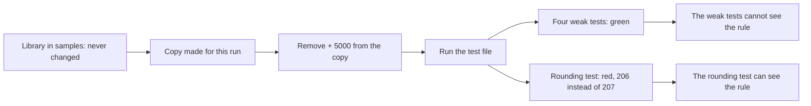

# Break the Rule

The last step showed four green tests. This step proves they are not checking anything, by breaking the library.

The marked line is the tax rule. It adds 5000 before dividing by 10000, which is what rounds half a cent up. Edit your copy of the library. Remove the `+ 5000`, so the tax rounds down instead. Do not change the library in `samples`. The runner uses a copy, and the change disappears when you finish.

Then press Run. Read the results before you do anything else. The test file has the four weak tests, and one new test that checks the tax on invoice 1002 is 207 cents, rounded half up.

Here is what you should see:

- The four weak tests pass. They do not depend on the rule, so a broken rule cannot make them fail.
- The new test fails. It checks the rule, and the broken rule gives 206 cents.

That is the lesson in one run. A test that can fail against a broken rule is worth having. A test that cannot is only a green light.

The diagram follows the experiment from the copy of the library to the two results. Compare each result with the claim it tests.

> **Common mistake.** Restoring the `+ 5000` after the failure, and then calling the test fixed. The failure is the evidence. Keep the broken copy long enough to read the failure, then put the rule back.

This is homework. Make the change yourself, and Run. Press Show solution (spoiler) only after you have tried it. The solution is the unbroken library. Run it, and every test should pass.

---
