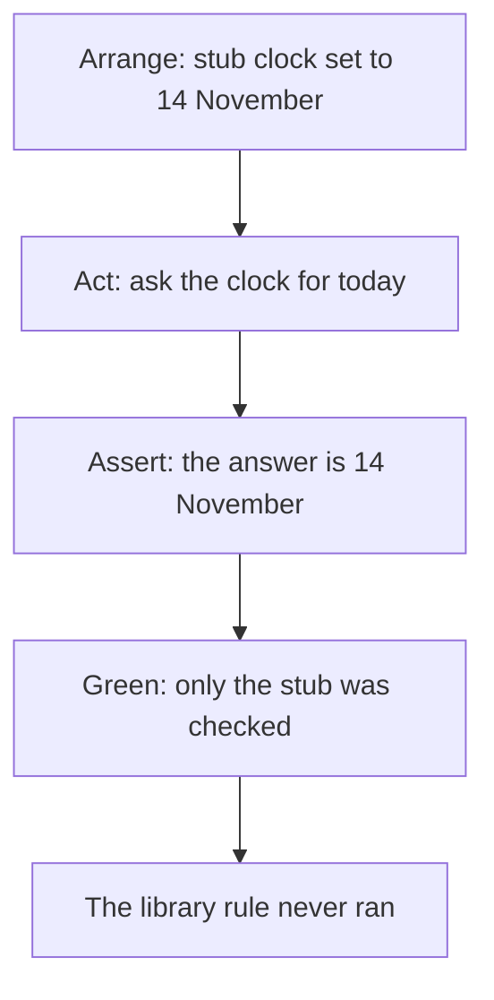
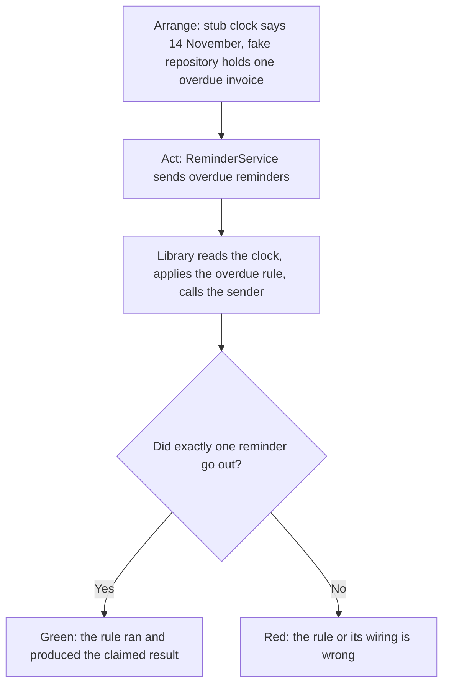

# A Test of the Mock

Some tests check the double instead of the program. They look like tests, and they are green, but their claim is about the stub, not the code.

The first test sets the stub clock to return 14 November, then asserts that the clock returns 14 November. The program is never involved. The assert can only pass, because the stub was told what to say. If the library's rule for overdue invoices were deleted, this test would still pass. A test that checks a stub has no claim about the library.

The second test asserts that the total is not null. A total is a whole number of cents, so it is never null in any port. The check can pass for any answer, including a wrong one. It proves the function returned something, and nothing about what it returned. A not-null check is useful only as a first check, followed by a check on the value.

Here are both tests in each language:

~~~examples readonly
```csharp
var clock = Substitute.For<IClock>();
clock.Today().Returns("2026-11-14");
Assert.That(clock.Today(), Is.EqualTo("2026-11-14"));
```
```python
clock = Mock()
clock.today.return_value = "2026-11-14"
assert clock.today() == "2026-11-14"
```
```javascript
const today = mock.fn(() => '2026-11-14');
const clock = { today };
assert.equal(clock.today(), '2026-11-14');
```
~~~

The diagrams compare the first test with the test it should be. The first one follows the stub's answer and stops there. The second one runs the library's rule, so a broken rule can make it fail.

What the test checks now:



What it should check:



Run the tests. They pass on the real library, and they would pass if the library were broken in any way that still returned a number.

> **A rule of thumb.** If the test's arrange section sets a value and its assert section checks that same value, ask what the program did. If the answer is nothing, the test is about the double.

This step is not homework.

---
