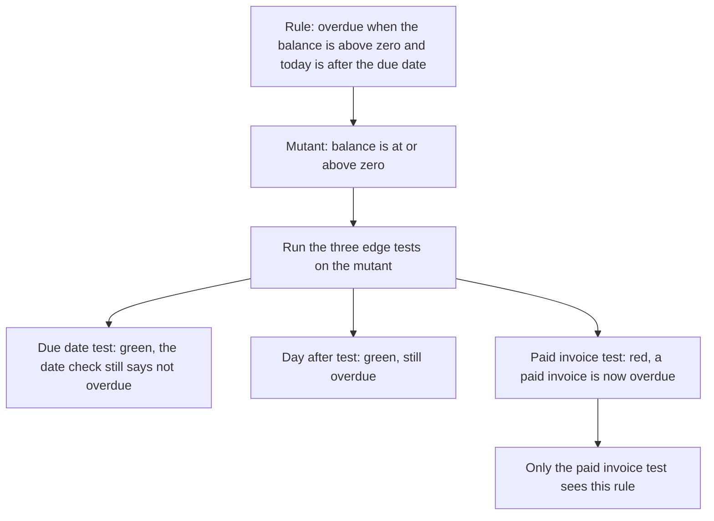

# Break the Boundary

The overdue rule has two parts: money must still be owed, and today must be after the due date. This step breaks the first part.

The marked line checks that the balance is above zero. Change `> 0` to `>= 0` in your copy of the library, and nothing else. A paid invoice has a balance of exactly zero, so the mutant now counts it as owed.

Run the three edge tests from chapter 10 against the mutant. Read the results before you change anything back. Predict first: which of the three tests should turn red, and why only that one?

The diagram follows the mutant through the three tests:

Only one test is red, because only one test has a balance of exactly zero. A mutant survives every test that never reaches the case it changes. That is the point of the step: the coverage of the rule depends on the cases the tests choose.

> **Common mistake.** Restoring the rule as soon as the result is red, without reading which test failed and why. The failure is the result of this step.

This is homework. Make the change yourself, and Run. Press Show solution (spoiler) only after you have tried it. The solution is the unbroken library. Run it, and all three tests should pass.

---
