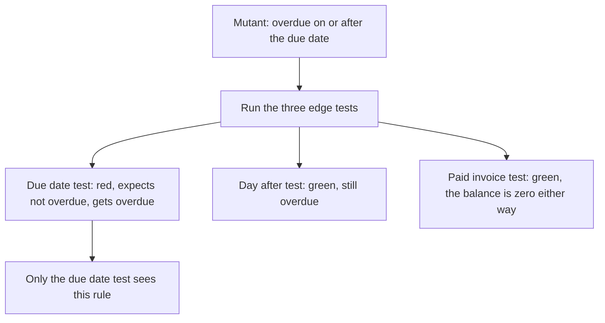

# Break the Due Date

The second part of the overdue rule is the date. Today must be after the due date, so the due date itself is not overdue. This step breaks that edge.

The marked line compares today with the due date. Change `>` to `>=` in your copy of the library, and nothing else. Now an invoice is overdue on the day it falls due.

Run the three edge tests against the mutant. Predict first: which test should turn red this time? It is a different test from the last step, and the reason is the point.

The diagram follows the mutant through the same three tests:

The two steps show that a different mutant needs a different test. The paid invoice test never reaches the date, and the due date test never has a zero balance. Together they catch both changes. Either one alone would miss one of them.

> **Common mistake.** Concluding that the suite is safe because the last step was caught. Each rule needs its own case, and this step tests a case the last one did not.

This is homework. Make the change yourself, and Run. Press Show solution (spoiler) only after you have tried it. The solution is the unbroken library.

---
