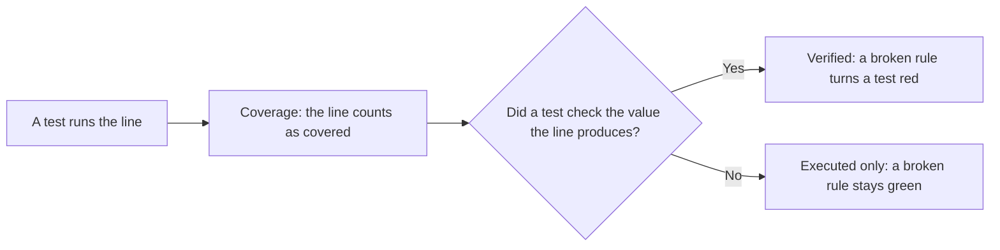

# Coverage Is a Signal

A coverage report counts the lines the tests ran. It is a useful signal, and it is easy to over-read.

A line that no test runs is a gap for certain. Nothing could have noticed a change to it. A line that a test does run is only half answered. The test ran the line, but the report does not know whether the test checked what the line decided.

The diagram separates the two questions a covered line can answer:

Dana's report said 94 percent. The rule that broke was on a line that was covered, and the test that ran it had no assertion on the result. The number was true, and it was no help.

Use coverage to find gaps. Do not use it as proof that the rules are checked. The mutants from the last two steps are a better test of that, because each one asks a direct question: if this rule were wrong, would a test notice?

> **Note on tools.** A coverage tool is not part of the homework in this tutorial. Its license has to be checked before it is added, and the roadmap records that step. The diagram above describes what any tool reports.

---
