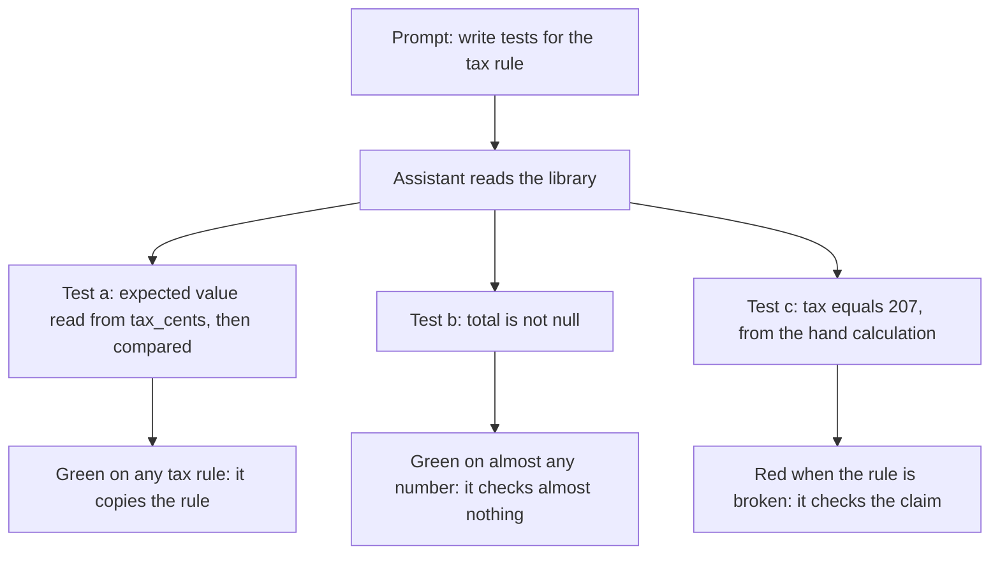

# Tests an Assistant Might Write

Here are three tests of the tax rule, of the kind an assistant might produce. All three pass on the real library. Read each one against its name and its comment, and ask what it would do if the rule were broken.

The first test reads its expected value from the library. The comparison can only ever agree with the rule it is supposed to check. The second test checks that a total is not null. Almost any number passes that. The third test uses 207, which you can work out from the claim by hand, before you run any code.

The diagram follows the three generated paths to their results. Only the last one is a check on the claim:

Run the three tests. They pass, and they are not homework. The third one is the kind of test you want, and the first two are the kind an assistant will write unless you stop it.

> **A rule of thumb.** If an expected value appears in the test without a hand calculation next to it, ask where it came from. If the answer is the library, the test copies the rule.

---
