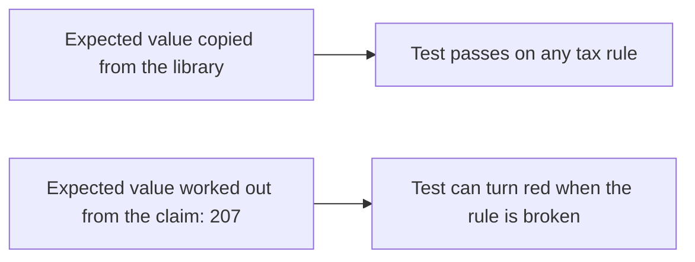

# The Value From the Claim

The starter test is a generated test, and its expected value has been left as a placeholder. Its comment says where the value must come from. Run it first. It fails, because the placeholder is not the tax.

Work out the tax on invoice 1002 by hand from the claim. Use the rule: the subtotal is 2505 cents, the rate is 825 basis points, and the tax is the subtotal times the rate, plus 5000, divided by 10000, with the remainder dropped. Write that number in the placeholder. Do not call the library to get it.

The diagram shows why the source of the number matters:

> **Common mistake.** Running the library, reading its answer, and typing that in. If the library were wrong, the test would agree with it, and the placeholder would have been filled with the bug. Work it out first, then run the test.

This is homework. Make the change yourself, and Run. Press Show solution (spoiler) only after you have tried it. The solution is the same test with 207 written in.

---
