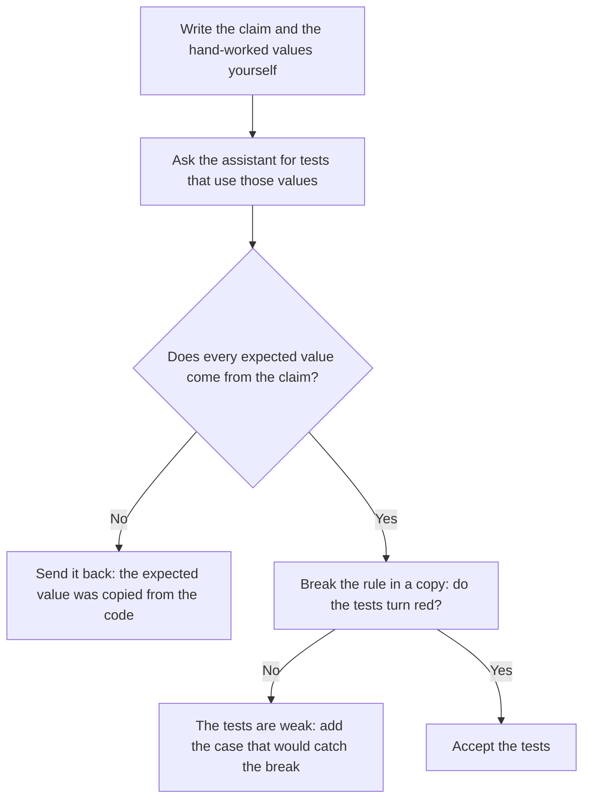

# Asking and Checking

Ask for tests in the other order from the one an assistant would choose. Write the claim and its hand-worked values first. Give the assistant those, and ask for tests that use them. Do not give it the library's answers, because it will copy them.

After the assistant replies, check the tests in three steps. First, every expected value should trace back to the claim. Second, the tests should fail on a broken copy of the rule. Third, you should be able to say what each test protects, in one sentence.

The diagram is the whole workflow:



A test that fails the second check is not worth keeping, however tidy it looks. The mutants from the last chapter are the tool for the second check, and they work the same way on generated tests as on your own.

For the wider picture of using AI to help write code, including how to review what an assistant produces, see the AI-assisted coding tutorial: https://github.com/databankimx/training-ai-assisted-coding

Three questions, one for each idea in the chapter.

```quiz
An assistant's test reads its expected value from the library. What is wrong with it?
○ Nothing. Reading the answer from the library saves time.
→ It saves time, and it removes the check. The test passes on any rule.
◉ Its expected value comes from the code under test, so it cannot catch a broken rule.
→ Right. A test that copies the rule agrees with the rule, right or wrong.
○ It is too long to be a unit test.
→ Length is not the problem. The source of the expected value is.
```

```quiz
Where should the expected values in a generated test come from?
○ From the assistant, because it has read the library.
→ The assistant may have read a buggy version, or copied the library's answer.
◉ From the claim and the hand calculation, written before the assistant starts.
→ Right. Then a broken rule can make the test fail.
○ From running the program and recording the output.
→ That records whatever the program does, bugs included.
```

```quiz
A generated test stays green when you break the rule in a copy of the library. What does that mean?
○ The test is good, because the rule still works in the real library.
→ The real library is not the question. The test must fail when the rule breaks.
◉ The test does not protect that rule, so it should be rewritten or removed.
→ Right. A test that survives a broken rule proves nothing about it.
○ The copy was made wrongly, so try again.
→ If the copy is wrong, check it. If the test stays green on a clearly broken rule, the test is the problem.
```

---
