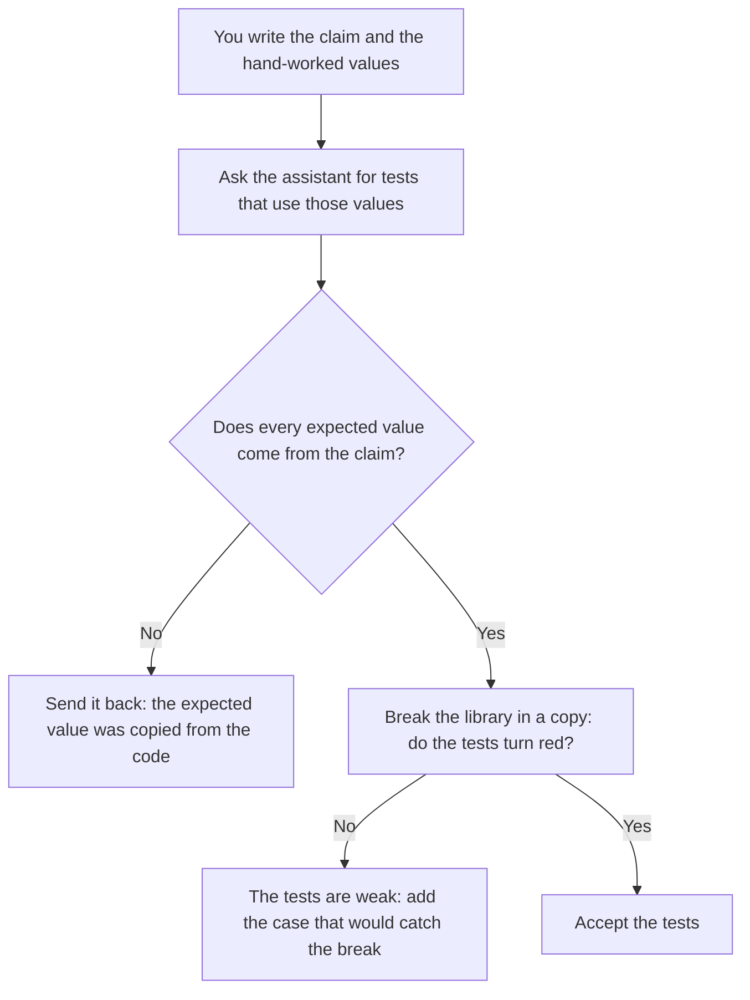

# 13. Using AI to Write Tests

An AI assistant can write a test in seconds, and the test will usually look right. It has a name, the three sections are in order, and the assertion is there. That is exactly why it needs checking. An assistant that reads the library is tempted to copy the library's answer into the expected value, because that is the easiest thing to write. A test written that way passes on any rule.

Dana asked an assistant to write tests for the tax rule. Every test came back green, including one that compared the library's answer with itself. The assistant was confident, and the tests were tidy. None of them could have failed, which Dana found out only by breaking the rule on purpose.

This chapter is brief. It covers the one habit that makes generated tests worth having: the claim and the hand-worked values come from you, before the assistant writes anything. For the wider picture of using AI to help write code, see the AI-assisted coding tutorial at https://github.com/databankimx/training-ai-assisted-coding.

> **Words used in this chapter.**
>
> - **Generated test:** a test an AI assistant wrote from your prompt or from the code.
> - **Hand-worked value:** an expected answer you calculate from the claim, before any code runs.

The diagram shows where the check belongs in the work:

---
