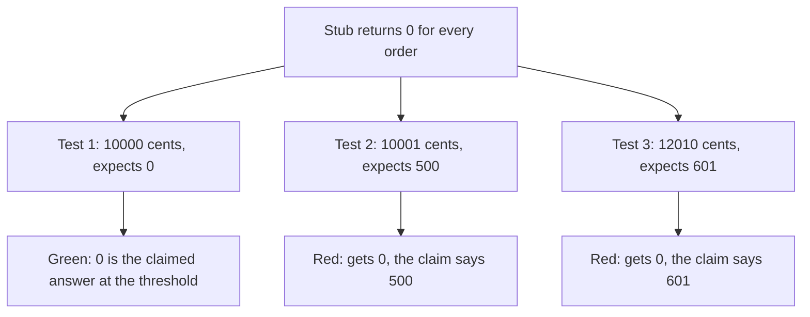

# Tests First

The sales team wants a volume discount: orders above 10000 cents, which is 100 dollars, get 5 percent off. The rule is written in plain words, and it has to be turned into tests before any code is written.

The discount is 5 percent of the subtotal, rounded half up to the cent. Work it out with the same formula the library uses for tax: the subtotal times 500, plus 5000, divided by 10000, dropping the remainder. Use 500 for the rate, because 5 percent is 500 basis points.

The three tests are below. The first is given: an order of exactly 10000 cents gets no discount, because the rule says above. The second and third have placeholders. Work out each value by hand from its claim, then write it in. Do not call the library.

The diagram shows what the stub gives for each test before you fill anything in:

Run the tests after you fill in the placeholders. The first test is green. The second and third are red, because the stub returns 0. That red is the result this step is looking for. The tests now describe the rule, and the code does not follow it yet.

> **Common mistake.** Reading the value from the library's output, or from a finished solution, and writing it in. A test written that way describes the stub, not the rule.

This is homework. Make the changes yourself, and Run. Press Show solution (spoiler) only after you have tried it. The solution is the same test file with the values filled in. It is still red against the stub, and that is expected.

---
