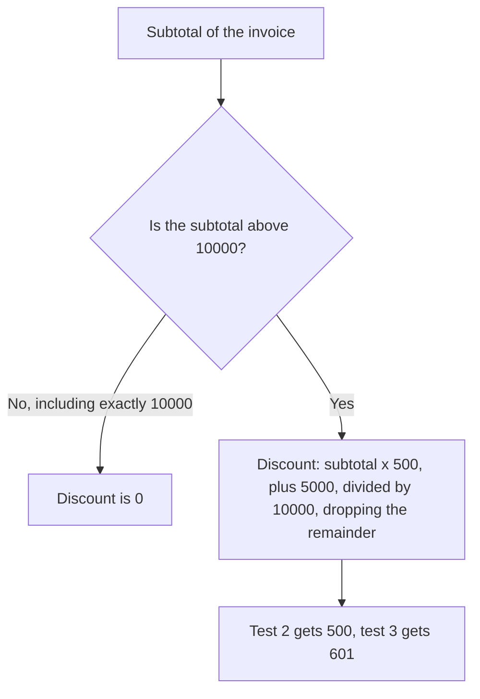
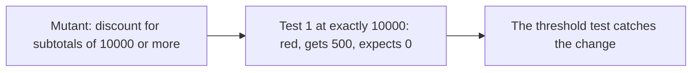

# Make the Tests Pass

The marked line is the stub. Replace it with the rule, in your copy of the library. Do not change the tests. They are the specification, and you have already checked the values by hand.

The rule has two branches. An order of 10000 cents or less gets no discount. An order above that gets 5 percent, rounded half up. The diagram is the whole decision:

Run the tests. All three should now be green.

The threshold is the easiest place to go wrong. If you write `>= 10000` where the rule says above, the first test turns red, because an order of exactly 10000 cents gets a discount it should not have. The diagram shows that mutant. It is the same kind of change you made in chapter 12.
Here is the mutant, drawn so you can see the failure:

> **Common mistake.** Changing the expected values in the tests until they match your code. If a test is red after you write the rule, read the failure and the claim. Only the code should change here.

This is homework. Make the change yourself, and Run. Press Show solution (spoiler) only after you have tried it. The solution is the full library with the rule in place.

---
