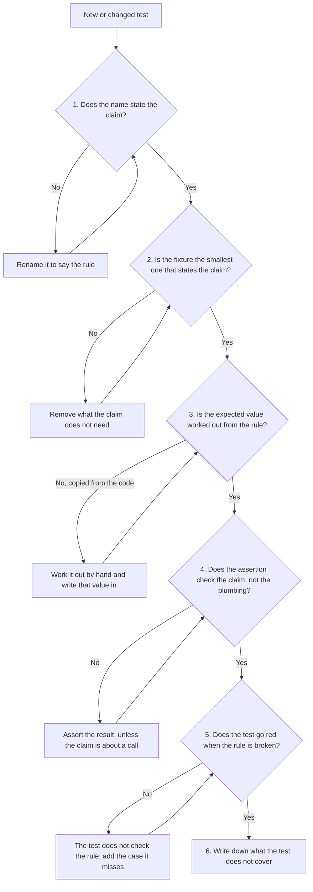

# Summary: A Checklist for a Useful Test

Use these six questions on any test you write or review. Each one is a question you can answer by reading the test and, where it helps, running it.

The diagram shows the order to ask them in. Each question either passes the test on to the next one, or sends you back to fix it:



## The checklist

1. **Name the claim.** The name should say what the rule does, in words a stranger could check. A name like `test_total_1` tells you nothing when the test fails. A name like `empty_invoice_has_zero_total` tells you what broke.

2. **Use the smallest fixture that states the claim.** Keep the data the claim needs, and remove the rest. A fixture with lines, payments and dates nobody reads is a test that hides its point. Builders and defaults, from chapter 6, help when the fixture is large.

3. **Work out the expected value from the rule.** Do the arithmetic by hand, the way you did for the tax and the late fee. If the expected value came from the code under test, the test cannot fail for a wrong rule. That is the copied expected value from chapter 3.

4. **Assert the claim, not the plumbing.** Check the result the claim is about. Check a call on a mock only when the claim is about the call, such as "a reminder is sent when an invoice is overdue." Counting calls to a clock or a helper, when the claim does not mention them, is the over-specified test from chapter 9.

5. **Break the rule on purpose.** Change the rule in a copy of the library, the way you did in chapters 11 and 12. The test should go red. If it stays green, the test does not check that part of the rule. Look at the boundaries: exactly on the threshold, just either side of it, and the empty case.

6. **Write down what the test does not cover.** Every test has a gap. Name it, in a comment or in your notes, so the next reader knows the limit. Coverage can help you find gaps, but a line that ran is not a value that was checked. That was the point of chapter 12.

## What you learned

- A test is only as good as the claim it makes. A name that states the claim is the first check.
- A small fixture makes the claim easy to read, and a hand-worked expected value makes it independent of the code.
- Mocks and stubs belong at the boundary. Check the calls only when the calls are the claim.
- The failure check is how you find out whether a test has teeth. Break the rule and see the red.
- Passing tests show that the code matches the tests. They do not show that the tests match the rule, and only a broken rule can show that.

## Quizzes

Three questions, one for each of the three ideas that matter most. Pick an answer, and read the explanation whichever way it goes.

```quiz
Which name tells you more when the test fails?
○ test_total_2
→ That tells you the test exists, but not what it checks. The name should state the claim.
◉ empty_invoice_has_zero_total
→ Right. When this fails, the name says which rule broke, before you open the file.
○ test_invoice
→ That name could cover any invoice test. A name should say the claim, not the object.
```

```quiz
You change the rule in a copy of the library, and the test still passes. What does that tell you?
○ The rule change was harmless, so you can keep it.
→ A change that no test notices is a change the tests do not protect. Find out which one.
◉ The test does not check that part of the rule, so the gap needs a new case.
→ Right. The failure check exists to find exactly this. Add the boundary case the test misses.
○ The library is wrong, and you should fix the test to match it.
→ The test was written from the rule, so the library is the thing to check against the rule first.
```

```quiz
All the tests pass, and coverage reports 100 percent. Are the tests useful?
◉ Not on their own. Coverage shows that lines ran, not that the values were checked.
→ Right. Run the failure check, and look at what each test actually asserts.
○ Yes. Full coverage means every rule is tested.
→ Coverage counts lines that ran. A line can run and still be checked against nothing.
○ No. Coverage tools are always wrong.
→ Coverage is useful. It just does not measure whether the tests check the right values.
```

